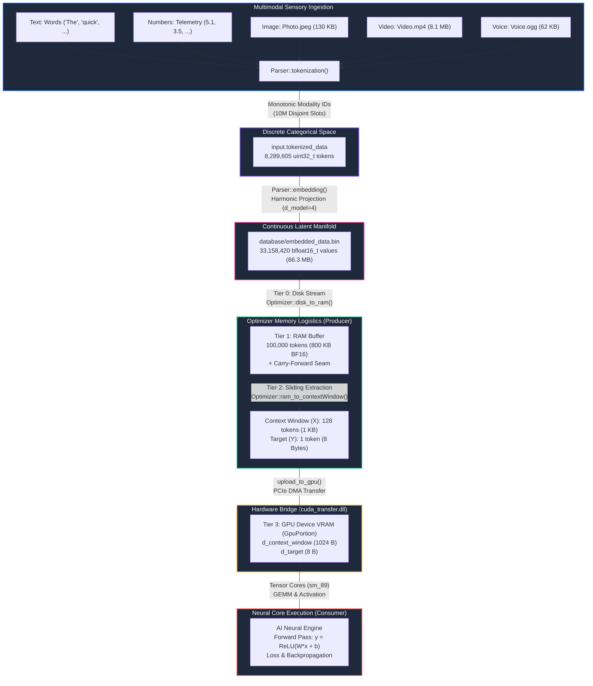

# AI Core: Native C++ Artificial Intelligence Engine

[](https://www.gnu.org/licenses/gpl-3.0)
[](#)
[](#)
[](#)
[](#)

Welcome to the **AI Core** technical documentation. AI Core is an open-source, zero-dependency artificial intelligence runtime engineered from fundamental principles in native C++23 and NVIDIA CUDA (sm_89). The project bridges the gap between atomic neural computational units (the native `AI` nucleus) and state-of-the-art foundation models (such as Meta's LLaMA, Chameleon, and Gemini-style early-fusion architectures).

---

## 1. Project Philosophy & Vision

Modern deep learning frameworks frequently hide fundamental computational mechanics behind heavyweight runtimes, dynamic Python bindings, and opaque memory managers. **AI Core** takes the opposite approach: complete architectural transparency, cache-conscious data structures, and deterministic systems programming in C++23.

```
========================================================================================
                               AI CORE EVOLUTIONARY ROADMAP
========================================================================================

  Stage 1: Atomic AI Foundation [COMPLETE]
  --------------------------------------------------------------------------------------
  * Atomic neural nucleus (class AI): inputs, weights, bias, dot-product accumulation
  * Activation functions and scalar loss metrics
  * Verification of forward computation accuracy

                                          |
                                          v

  Stage 2: Universal Multimodal Early-Fusion Perception [COMPLETE]
  --------------------------------------------------------------------------------------
  * Discrete tokenization across 5 sensory modalities (Text, Number, Image, Video, Audio)
  * Non-overlapping 10-million slot ID namespace allocation
  * Streaming binary ingestion directly from storage
  * Verifiable scale: 8,289,605 tokens generated across media assets

                                          |
                                          v

  Stage 3: Dense Latent Manifolds & Embedding Matrix [COMPLETE]
  --------------------------------------------------------------------------------------
  * Discrete Token ID -> Continuous Dense Vector projection
  * 16-bit Brain Float (std::bfloat16_t) representation (50% memory bandwidth saved)
  * Dynamic, deterministic harmonic embedding table
  * Verifiable scale: 786 unique vocabulary embeddings -> 33,158,420 dense BF16 floats
  * Persistent binary storage: database/embedded_data.bin (66.32 MB)

                                          |
                                          v

  Stage 4: 3-Tier Optimizer Logistics & CUDA Infrastructure [OPERATIONAL & VERIFIED]
  --------------------------------------------------------------------------------------
  * Multi-Tier Memory Pipeline: Disk (Tier 0) -> RAM Buffer (Tier 1) -> Context Window (Tier 2)
  * Carry-Forward Seam Preservation: Zero chunk boundary amnesia
  * Dual-compiler architecture: MinGW-w64 g++ (Host) + MSVC cl.exe & nvcc (Device)
  * High-speed dynamic bridge: cuda_transfer.dll exporting C ABI
  * Direct PCIe DMA transfers: 128-token context windows upload to GPU VRAM in ~32 ns
  * 62 passing unit tests across CPU logistics and live RTX 4080 GPU hardware

                                          |
                                          v

  Stage 5: Foundation Attention & LLaMA Primitives [UPCOMING]
  --------------------------------------------------------------------------------------
  * Scaled Dot-Product Attention & Multi-Head Self-Attention (MHA)
  * Rotary Positional Embeddings (RoPE)
  * RMSNorm pre-normalization & SwiGLU gated activations
  * Autoregressive Key-Value (KV) Cache mechanics in VRAM
========================================================================================
```

---

## 2. Visualized System Architecture & Data Flow



---

## 3. Technical Documentation Index

All architectural specifications, memory models, algorithms, and engineering guidelines are maintained in modular documents:

| Specification Document | Focus Area |
| :--- | :--- |
| **[Multimodal Architecture Specification](learning/deepLearning/document/architecture.md)** | Early-fusion discrete tokenization, universal sequence design, 10M ID offset spacing, Conductor orchestration, and subsystem isolation. |
| **[Tokenization & Embeddings](learning/deepLearning/document/tokenization_and_embeddings.md)** | Binary streaming, byte-level quantization, exact token census (8.28M tokens), and dense `bfloat16_t` vector projection. |
| **[The "Life and Death" Guarantee](learning/deepLearning/document/life_and_death_guarantee.md)** | Multi-tier buffer state locks (`buffer_in_use`, `context_in_use`), Carry-Forward seam preservation, and weight-poisoning prevention. |
| **[Memory Hierarchy & Hardware](learning/deepLearning/document/memory_hierarchy_and_hardware.md)** | 4-tier memory model (NVMe $\rightarrow$ Host RAM $\rightarrow$ Context Window $\rightarrow$ GPU VRAM), footprint analysis, and PCIe latency benchmarks. |
| **[C++ Design Patterns & Data Structures](learning/deepLearning/document/data_structures_and_cpp_design.md)** | C++23 systems programming, `add_assign_increase<T>`, type safety (`uint8_t`/`uint32_t`/`bfloat16_t`), and C ABI dynamic library isolation. |
| **[Build & Toolchain Guide](learning/deepLearning/document/build_and_toolchain.md)** | Dual-compiler toolchain (MinGW + MSVC nvcc), Makefile targets, `cuda_transfer.dll`, test harnesses, and live verification logs. |

---

## 4. Empirical System Benchmark

The complete verification harness executes natively against active media samples in `asset_sample/`:

| Modality | Source Entity | Raw Size | Generated Tokens | Unique Vocab IDs | Active ID Range |
| :--- | :--- | :--- | :--- | :--- | :--- |
| **Text** | In-Memory Words | 9 entries | 9 | 9 | `[1 .. 9]` |
| **Number** | In-Memory Doubles | 12 entries | 12 | 9 | `[10000000 .. 10000008]` |
| **Image** | `Photo.jpeg` | 130,513 B | 130,513 | 256 | `[20000000 .. 20000255]` |
| **Video** | `Video.mp4` | 8,096,817 B | 8,096,817 | 256 | `[30000000 .. 30000255]` |
| **Voice** | `Voice.ogg` | 62,254 B | 62,254 | 256 | `[40000000 .. 40000255]` |
| **TOTAL** | — | **8.289 MB** | **8,289,605** | **786** | **Disjoint 10M Blocks** |

---

## 5. Repository Directory Layout

```
learning/deepLearning/
├── Makefile                          # Unified build rules (all, test, clean, cuda_transfer.dll)
├── cuda_transfer.dll                 # Compiled GPU transfer bridge (MSVC C ABI)
├── asset_sample/                     # Real multimodal binary media test files
│   ├── Photo.jpeg                    # Visual sample asset (130 KB)
│   ├── Video.mp4                     # Temporal video sample asset (8.1 MB)
│   └── Voice.ogg                     # Acoustic audio sample asset (62 KB)
├── database/                         # Generated model data
│   └── embedded_data.bin             # Contiguous bfloat16_t latent stream (66.3 MB)
├── document/                         # Technical specifications & design docs
│   ├── architecture.md               # Multimodal early fusion & pipeline specification
│   ├── build_and_toolchain.md        # Toolchain, flags, dual-compiler, and test harness
│   ├── data_structures_and_cpp_design.md # C++23 design patterns & data types
│   ├── life_and_death_guarantee.md   # Synchronization locks & seam preservation
│   ├── memory_hierarchy_and_hardware.md # 4-tier memory model & VRAM budget
│   └── tokenization_and_embeddings.md# Tokenizer mechanics & BF16 vectors
├── include/                          # Header definitions
│   ├── ai.hpp                        # AI class & Key_Concepts definitions
│   ├── optimizer.hpp                 # Portion struct & Optimizer data loader
│   ├── parser.hpp                    # Input, Test, and Parser declarations
│   └── training.hpp                  # Train struct & Training interface
├── ref/                              # Visual architectural reference assets
│   ├── Ai.jpg                        # Early neural network references
│   └── Deep_Learning.jpg             # Multimodal latent space diagrams
├── src/                              # Core application implementation
│   ├── CUDA/                         # GPU CUDA device implementations
│   │   ├── transfer.cu               # Device memory upload/download/free kernels
│   │   └── transfer.cuh              # C ABI bridge interface & GpuPortion struct
│   ├── ai.cpp                        # AI nucleus forward pass
│   ├── main.cpp                      # Test runner entry point
│   └── training.cpp                  # Training orchestration prototype
├── test/                             # Modular test verification suites
│   ├── run_test.ps1                  # Standalone verification script
│   ├── test_cuda_transfer.cpp        # 32 GPU & BF16 transfer unit tests
│   ├── test_embeddings.cpp           # BF16 embedding unit test harness
│   ├── test_header.hpp               # Header path inspection helper
│   ├── test_ifstream.cpp             # Binary I/O test suite
│   ├── test_optimizer.cpp            # 30 Optimizer & Portion state unit tests
│   ├── test_path.cpp                 # Path resolution test suite
│   └── test_tokenization.cpp         # Tokenization & embedding verification
└── util/                             # Systems utilities & data parsers
    ├── optimizer.cpp                 # 3-tier streaming & carry-forward implementation
    └── parser.cpp                    # Multimodal tokenizer & BF16 embedding logic
```

---

## 6. Quickstart & Build Instructions

### Prerequisites
- Standard C++23 compliant compiler (`g++` >= 13.0 with MinGW-w64).
- NVIDIA CUDA Toolkit (v12.0+ / v13.3) with NVIDIA GPU (RTX 4080 Laptop, sm_89).
- Microsoft Visual Studio 2022 Build Tools (providing `cl.exe` for `nvcc`).
- GNU Make or MinGW32-Make (`mingw32-make` on Windows).

### Build Targets

```bash
# Build both app and test binaries with CUDA DLL
mingw32-make all

# Run the complete 62-test verification suite
mingw32-make test

# Clean build artifacts
mingw32-make clean
```

---

## 7. License

This project is licensed under the **GNU General Public License v3 (GPL-3.0)**.
