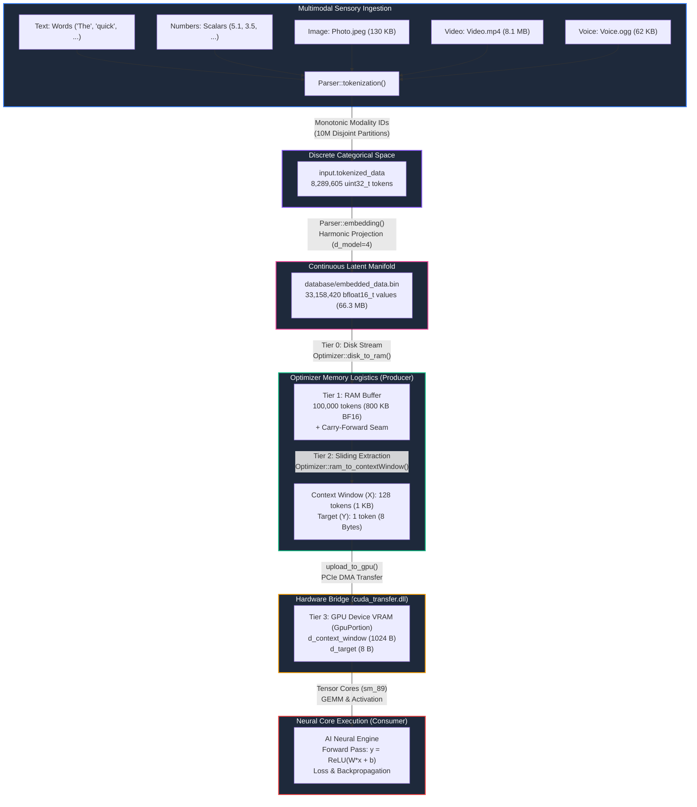
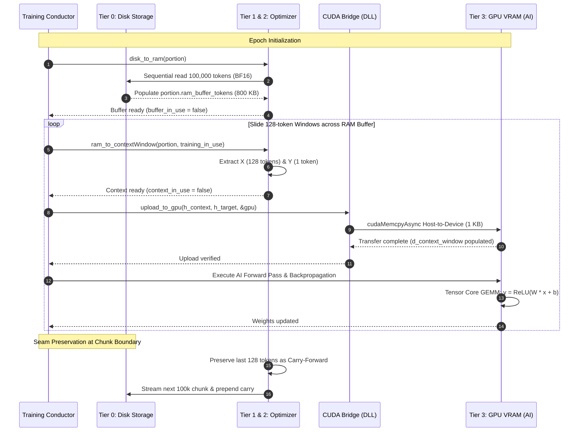

# AI Core: Multimodal Early-Fusion Architecture Specification

```
Document Version : 3.0.0
Standard         : ISO/IEC 14882:2023 (C++23)
Classification   : Technical Design Specification & Systems Architecture
Architecture     : Early-Fusion Multimodal Tokenizer, BF16 Latent Manifold & CUDA Bridge
Target Hardware  : NVIDIA GeForce RTX 4080 (Ada Lovelace, sm_89) / Host CPU
```

---

## 1. Architectural Philosophy: The Case for Early Fusion

Artificial intelligence architectures face a fundamental design decision when ingesting heterogeneous sensory inputs (natural language, scalar telemetry, high-resolution imagery, temporal video, and acoustic audio):

```
+---------------------------------------------------------------------------------------+
| COMPETING MULTIMODAL PARADIGMS IN FOUNDATION MODELS                                   |
+---------------------------------------------------------------------------------------+

1. LATE FUSION (Cross-Attention Encoders — e.g., CLIP, Flamingo, Whisper-LLM)
   -------------------------------------------------------------------------------------
   Text       ---> [ Text Tokenizer ]       ---> [ Transformer Decoder ]
                                                        ^
   Image/Audio ---> [ Heavy Pretrained Vision ] ---> [ Cross-Attention ]
                    [ / Audio Transformer    ]
   * Drawbacks: Massive parameter bloat, separate heterogeneous networks, synchronization
     bottlenecks, and discontinuous representation spaces.

2. EARLY FUSION (Universal Discrete Codebook — e.g., Gemini, Chameleon, AI Core)
   -------------------------------------------------------------------------------------
   Text       ---> [ Word Hash / BPE ]  --+
   Numbers    ---> [ Scalar Binning  ]    |---> [ Unified Sequence ] ---> [ Shared ]
   Image      ---> [ Byte VQ Quant   ]    |     (tokenized_data)          [ Neural ]
   Video      ---> [ Temporal Quant  ]    |     8,289,605 tokens          [ Core   ]
   Voice      ---> [ Audio Quant     ]  --+                               [ (AI)   ]
   * Advantages: Single sequence buffer, uniform self-attention, modality agnosticism,
     and maximum architectural simplicity.
+---------------------------------------------------------------------------------------+
```

**AI Core** implements the **Early Fusion** paradigm. At the earliest perceptual interface, all incoming signals are converted into a single unified stream of discrete categorical identifiers (`std::vector<uint32_t> tokenized_data`), which are subsequently projected into a shared continuous embedding space (`std::vector<std::bfloat16_t> embedded_data`).

---

## 2. Visualized System Architecture & Data Flow

The end-to-end architecture connects raw sensory ingestion on disk to hardware-accelerated tensor computation in GPU VRAM:



---

## 3. The Producer-Consumer Architecture & Conductor Orchestration

The deep learning data pipeline is a textbook implementation of the **Producer-Consumer Problem**:
- **Producer:** The `Optimizer` DataLoader (reads chunks from disk, extracts tokens, structures sliding context windows).
- **Consumer:** The `AI` Neural Core (ingests the context window, multiplies against weights, updates gradients).

### 3.1 The Conductor Model (Single-Threaded Deterministic Execution)



The training loop acts as a strict orchestra conductor. The Conductor tells the Optimizer to carve out a 128-token window and wait. The Optimizer returns control. The Conductor then transfers tensors over PCIe to GPU VRAM and commands the AI to consume the data. No concurrent tasks run uncoordinated; everything is predictable, guaranteeing absolute synchronization without race conditions or deadlocks.

---

## 4. Universal Discrete Token Space & Namespace Partitioning

### 4.1 The Cross-Modal Semantic Collision Problem

When multiple sensory streams are flattened into a single sequence, catastrophic semantic collision occurs if identical integer identifiers are assigned to different concepts across modalities:

$$\text{Let } \text{ID}(w) \in \mathbb{Z}^+ \text{ be the token mapping function.}$$

If $\text{ID}(\text{"The"}) = 1$ and $\text{ID}(\text{Pixel}_{0}) = 1$, the downstream embedding lookup table assigns the exact same geometric vector to an English grammatical article and an absolute-black image pixel.

### 4.2 The 10,000,000-Slot Disjoint Allocation

To guarantee zero mathematical overlap while maintaining complete modality agnosticism in downstream layers, **AI Core** establishes fixed 10-million integer intervals for each sensory domain:

```
[0]               [10,000,000]       [20,000,000]       [30,000,000]       [40,000,000]       [50,000,000]
 +------------------+------------------+------------------+------------------+------------------+
 |   Text Modality  |  Number Modality |  Image Modality  |  Video Modality  |  Voice Modality  |
 |   [1..9,999,999] |  [10M..19,999,999|  [20M..29,999,999|  [30M..39,999,999|  [40M..49,999,999|
 +------------------+------------------+------------------+------------------+------------------+
```

| Sensory Domain | Active ID Counter | Counter Init | Theoretical Capacity | Active Dictionary Key Type | Dictionary Storage Container |
| :--- | :--- | :--- | :--- | :--- | :--- |
| **Natural Language** | `next_text_id` | `1` | 9,999,999 tokens | `std::string` | `std::unordered_map<std::string, uint32_t>` |
| **Tabular Numbers** | `next_number_id` | `10,000,000` | 10,000,000 tokens | `double` | `std::unordered_map<double, uint32_t>` |
| **Visual Imagery** | `next_image_id` | `20,000,000` | 10,000,000 tokens | `uint8_t` | `std::unordered_map<uint8_t, uint32_t>` |
| **Temporal Video** | `next_video_id` | `30,000,000` | 10,000,000 tokens | `uint8_t` | `std::unordered_map<uint8_t, uint32_t>` |
| **Acoustic Audio** | `next_voice_id` | `40,000,000` | 10,000,000 tokens | `uint8_t` | `std::unordered_map<uint8_t, uint32_t>` |

---

## 5. Subsystem Topology & Decoupling

Following the Single Responsibility Principle and modern systems-engineering guidelines, **AI Core** isolates perceptual transformation from neural processing:

```mermaid
graph LR
    subgraph FRONTEND["Perceptual Frontend"]
        P_IN["struct Input & Test<br/>(State Containers)"] --> PARSER["class Parser<br/>(Tokenization & Embeddings)"]
    end

    subgraph LOGISTICS["Memory Logistics"]
        PARSER -->|"database/embedded_data.bin"| OPT["class Optimizer<br/>(3-Tier Streaming & Seams)"]
    end

    subgraph HARDWARE_BRIDGE["Hardware Transfer Bridge"]
        OPT -->|"GpuPortion & upload_to_gpu()"| DLL["cuda_transfer.dll<br/>(MSVC C ABI Export)"]
    end

    subgraph NEURAL_BACKEND["Cognitive Execution"]
        DLL -->|"Device Pointers (VRAM)"| AI_CLASS["class AI<br/>(Tensor Cores & Forward Pass)"]
    end

    style FRONTEND fill:#0f172a,stroke:#38bdf8,stroke-width:1px,color:#fff
    style LOGISTICS fill:#0f172a,stroke:#34d399,stroke-width:1px,color:#fff
    style HARDWARE_BRIDGE fill:#0f172a,stroke:#fbbf24,stroke-width:1px,color:#fff
    style NEURAL_BACKEND fill:#0f172a,stroke:#f87171,stroke-width:1px,color:#fff
```



### Component Responsibilities:

1. **`struct Test` (`include/parser.hpp`)**:
   - Represents the developer mock environment (`developer_mode = true`).
   - Encapsulates sample text tokens (`data_txt`) and scalar telemetry (`data_num`).
2. **`struct Input` (`include/parser.hpp`)**:
   - Holds all global vocabulary dictionaries (the discrete VQ codebooks).
   - Manages monotonic ID allocation counters.
   - Houses production user input buffers (`user_text`, `user_numbers`, media path vectors).
   - Stores the persistent embedding table (`embedding_table`) and unified output vectors (`tokenized_data`, `embedded_data`).
3. **`class Parser` (`include/parser.hpp`, `util/parser.cpp`)**:
   - Executes discrete tokenization across all five sensory modalities.
   - Manages disk streaming and path resolution (`tokenize_from_disk`).
   - Implements the generic insertion routine `add_assign_increase<T>()`.
   - Synthesizes dense continuous BF16 embedding tensors (`Parser::embedding()`).
   - **Strict Constraint:** Possesses zero dependencies on neural weights, gradients, or loss functions.
4. **`class Optimizer` (`include/optimizer.hpp`, `util/optimizer.cpp`)**:
   - Manages 3-tier memory streaming: Disk $\rightarrow$ RAM Buffer $\rightarrow$ Context Window.
   - Enforces the Life and Death Data Synchronization Guarantee via `buffer_in_use` and `context_in_use` state locks.
   - Implements Carry-Forward seam preservation to eliminate chunk boundary amnesia.
5. **`cuda_transfer.dll` (`src/CUDA/transfer.cu`, `src/CUDA/transfer.cuh`)**:
   - Inter-compiler ABI bridge: Compiled by MSVC `cl.exe` + `nvcc`, consumed by MinGW `g++`.
   - Manages GPU device allocations (`cudaMalloc`, `cudaMemcpy`, `cudaFree`) inside `GpuPortion`.
   - Features intelligent buffer reuse to avoid per-window reallocation overhead.
6. **`class AI` (`include/ai.hpp`, `src/ai.cpp`)**:
   - Represents the core cognitive nucleus.
   - Accepts raw numerical inputs (`Key_Concepts`), weights, biases, and computes forward projections.
   - **Strict Constraint:** Possesses zero awareness of string tokens, file paths, or perceptual dictionaries.

---

## 6. End-to-End Pipeline Execution Flow

```
+---------------------------------------------------------------------------------------+
| STAGE 1: PERCEPTUAL INGESTION (Parser::tokenization)                                  |
+---------------------------------------------------------------------------------------+
  1. Text words iterated from test.data_txt:
     "The" -> ID 1, "quick" -> ID 2, ..., "dog" -> ID 9.
  2. Numbers iterated from test.data_num:
     5.1 -> ID 10,000,000, 3.5 -> ID 10,000,001, ..., 0.2 -> ID 10,000,003 (reused).
  3. Image file "Photo.jpeg" streamed byte-by-byte:
     Each byte b in [0..255] mapped to image_dictionary[b] in [20,000,000 .. 20,000,255].
  4. Video file "Video.mp4" streamed byte-by-byte:
     Each byte b in [0..255] mapped to video_dictionary[b] in [30,000,000 .. 30,000,255].
  5. Audio file "Voice.ogg" streamed byte-by-byte:
     Each byte b in [0..255] mapped to voice_dictionary[b] in [40,000,000 .. 40,000,255].
  -> Result: 8,289,605 discrete tokens placed into input.tokenized_data.

                                          |
                                          v

+---------------------------------------------------------------------------------------+
| STAGE 2: DENSE PROJECTION (Parser::embedding)                                         |
+---------------------------------------------------------------------------------------+
  1. For each token ID in input.tokenized_data:
     - Check if token ID exists in input.embedding_table.
     - If absent: generate deterministic d_model vector (d = 4) via:
       v[d] = static_cast<std::bfloat16_t>(sin(id * (d + 1.0)))
     - Insert dense vector into input.embedding_table[token_id].
     - Append dense slice to input.embedded_data.
  2. Save entire contiguous sequence to database/embedded_data.bin (66,316,840 bytes).
  -> Result: 33,158,420 continuous bfloat16_t values (8.289M tokens * 4 dimensions).

                                          |
                                          v

+---------------------------------------------------------------------------------------+
| STAGE 3: THREE-TIER OPTIMIZER STREAMING (Optimizer::disk_to_ram, ram_to_contextWindow)|
+---------------------------------------------------------------------------------------+
  1. Optimizer streams 100,000 tokens (400,000 BF16 values = 800 KB) into RAM buffer.
  2. Extracts sliding 128-token context window (512 BF16 values = 1,024 bytes) and target.
  3. Preserves seam tokens as carry-forward before replenishing RAM buffer from disk.

                                          |
                                          v

+---------------------------------------------------------------------------------------+
| STAGE 4: HOST-TO-DEVICE TRANSFER & NEURAL EXECUTION (cuda_transfer.dll / Tensor Cores)|
+---------------------------------------------------------------------------------------+
  1. Host CPU calls upload_to_gpu() to push 1 KB context window over PCIe to GPU VRAM.
  2. GPU Tensor Cores execute massive parallel dot-product kernels:
     y = dot_product(X, W) + b
  3. Non-linear activation evaluation (ReLU, GELU, SwiGLU).
  4. Scalar error computation against ground truth target Y.
```

---

## 7. Architectural Trajectory Toward Foundation Attention Models

The current architecture establishes the exact sequence formatting required for modern Transformer and LLaMA foundation models:

1. **RMSNorm (Root Mean Square Normalization):**
   $$\bar{x}_i = \frac{x_i}{\sqrt{\frac{1}{d} \sum_{j=1}^d x_j^2 + \epsilon}} \cdot \gamma_i$$
2. **Rotary Positional Embeddings (RoPE):**
   Encodes sequence order directly onto the projected $Q$ and $K$ vectors without requiring additive absolute positional embeddings.
3. **SwiGLU Gated Feed-Forward Networks:**
   $$\text{SwiGLU}(x) = \left( x \mathbf{W}_1 \cdot \text{sigmoid}(x \mathbf{W}_1) \right) \cdot (x \mathbf{W}_2)$$
4. **Autoregressive KV Cache:**
   Persisting key and value projection tensors across generative steps in GPU VRAM to prevent redundant matrix multiplications.
