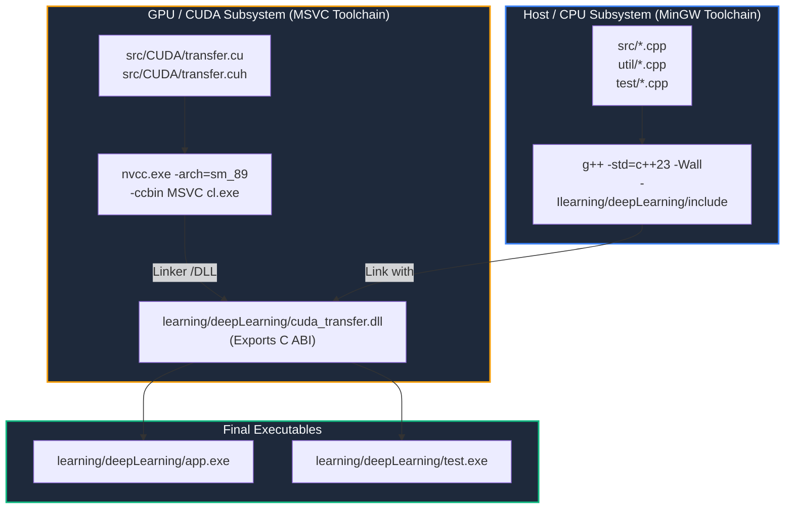

# AI Core: Build System, Toolchain & Testing Specification

```
Document Version : 3.0.0
Standard         : ISO/IEC 14882:2023 (C++23)
Classification   : Systems Toolchain & Continuous Verification
Build Tool       : GNU Make / MinGW32-Make
Compiler Targets : Host: MinGW-w64 g++ (C++23) | Device: NVIDIA nvcc + MSVC 2022 (sm_89)
Shared Bridge    : cuda_transfer.dll (C ABI Export)
```

---

## 1. Build System Architecture & Dual-Compiler Strategy

The build process for **AI Core** is governed by a unified GNU Makefile located at the project root (`Makefile`).

On Windows, NVIDIA's `nvcc` compiler strictly mandates Microsoft Visual C++ (`cl.exe`) as its host compiler backend, whereas the host AI Core codebase leverages modern ISO C++23 features via MinGW-w64 `g++`. Direct static object linking between MinGW and MSVC causes fatal ABI mismatches and mangled symbol errors.

To solve this fundamentally, **AI Core** uses a **Dynamic Shared Library (DLL) Bridge**:
1. `nvcc` invokes MSVC `cl.exe` to compile CUDA kernels (`transfer.cu`) into `cuda_transfer.dll`.
2. All CUDA functions and data types are exported across the boundary using strict C ABI semantics (`extern "C"` and `__declspec(dllexport)`).
3. MinGW-w64 `g++` compiles CPU sources with `-std=c++23` and dynamically links directly against `cuda_transfer.dll`.



---

## 2. Makefile Breakdown & Build Targets

```makefile
CXX      = g++
CXXFLAGS = -Wall -std=c++23 -Ilearning/deepLearning/include

# ─── CUDA ────────────────────────────────────────────────────────────────────
CUDA_DIR  = C:/Program Files/NVIDIA GPU Computing Toolkit/CUDA/v13.3
NVCC      = "$(CUDA_DIR)/bin/nvcc.exe"
NVCCFLAGS = -arch=sm_89 --std=c++17 -ccbin "C:\Program Files (x86)\Microsoft Visual Studio\2022\BuildTools\VC\Tools\MSVC\14.44.35207\bin\Hostx64\x64" \
            -I"$(CUDA_DIR)/include"

CUDA_SRC_DIR = learning/deepLearning/src/CUDA
CUDA_SRCS    = $(wildcard $(CUDA_SRC_DIR)/*.cu)
CUDA_DLL     = learning/deepLearning/cuda_transfer.dll

# ─── CPU sources ─────────────────────────────────────────────────────────────
SRC_DIR   = learning/deepLearning/src
TEST_DIR  = learning/deepLearning/test
UTIL_DIR  = learning/deepLearning/util

UTIL_SRCS = $(wildcard $(UTIL_DIR)/*.cpp)
ALL_SRCS  = $(wildcard $(SRC_DIR)/*.cpp) $(wildcard $(TEST_DIR)/*.cpp) $(UTIL_SRCS)
APP_SRCS  = $(ALL_SRCS)
TEST_SRCS = $(ALL_SRCS)

# ─── Output targets ──────────────────────────────────────────────────────────
APP_TARGET  = learning/deepLearning/app.exe
TEST_TARGET = learning/deepLearning/test.exe
```

### 2.1 Target Definitions

| Target | Command | Purpose |
| :--- | :--- | :--- |
| `$(CUDA_DLL)` | `$(NVCC) ... -shared` | Compiles GPU kernel sources into the dynamic library `cuda_transfer.dll`. |
| `all` | `mingw32-make all` | Compiles both `app.exe` and `test.exe` binaries linked with the CUDA DLL. |
| `test` | `mingw32-make test` | Builds `test.exe` (if out-of-date) and immediately executes the 62-test verification suite. |
| `clean` | `mingw32-make clean` | Removes compiled binaries (`app.exe`, `test.exe`). |

---

## 3. Compilation Flags & Systems Rationale

```bash
g++ -Wall -std=c++23 -Ilearning/deepLearning/include ...
```

- `-std=c++23`: Activates ISO C++23 language features, specifically:
  - Native `std::bfloat16_t` floating-point type support via `<stdfloat>`.
  - `std::filesystem::path` and path decomposition operators.
  - Multi-dimensional subscript operators and advanced ranges.
  - Structured binding declarations (`for (const auto& [key, id] : dict)`).
- `-Wall`: Activates all standard compiler diagnostic warnings, ensuring zero silent type mismatches, signed/unsigned comparisons, or uninitialized variables.
- `-Ilearning/deepLearning/include`: Adds the header directory to the compiler's include search path, enabling clean `#include "parser.hpp"`, `#include "optimizer.hpp"`, and `#include "ai.hpp"` directives.
- `-arch=sm_89`: Generates machine code specifically targeting the NVIDIA Ada Lovelace architecture (GeForce RTX 4080 Laptop GPU, compute capability 8.9), unlocking 4th-generation Tensor Cores.

---

## 4. Test Harness Topology & Verification Suites

The test executable (`learning/deepLearning/test.exe`) is invoked from `src/main.cpp` and coordinates six modular test suites:

```
+---------------------------------------------------------------------------------------------------------+
|                                           TEST HARNESS TOPOLOGY                                         |
+---------------------------------------------------------------------------------------------------------+

                                                [ src/main.cpp ]
                                                        |
       +-----------------+---------------+--------------+---------------+----------------+----------------+
       |                 |               |              |               |                |                |
       v                 v               v              v               v                v                v
 [ test_path() ]  [ test_ifstream() ]  [ test_embeddings ] [ test_tokenization ] [ test_optimizer ] [ test_cuda_transfer ]
 (test_path.cpp)  (test_ifstream.cpp)  (test_embeddings.cpp) (test_tokenization.cpp) (test_optimizer.cpp) (test_cuda_transfer.cpp)
       |                 |               |              |               |                |
  Path resolution   Binary I/O on    BF16 Embedding   Multimodal      30 Unit Tests:   32 Unit Tests:
  via __FILE__      sample Photo     validation &     Census &        Portion state,   BF16 layout &
                    stream flags     file output      summary         seams, cycles    GPU roundtrip
```

### 4.1 Test Suite Breakdown

1. **`test_path()` (`test/test_path.cpp`, `test/test_header.hpp`)**:
   - Inspects compile-time `__FILE__` macros.
   - Verifies relative-to-absolute path traversal to `asset_sample/Photo.jpeg`.
2. **`test_ifstream()` (`test/test_ifstream.cpp`)**:
   - Opens `Photo.jpeg` via `std::ifstream` in `std::ios::binary` mode.
   - Validates low-level stream state flags.
3. **`test_embeddings()` (`test/test_embeddings.cpp`)**:
   - Validates that tokenization generates non-empty categorical sequence buffers.
   - Asserts non-overlapping ID spaces across all 5 modalities.
   - Asserts that embedding vector size exactly matches $N_{\text{tokens}} \times d_{\text{model}}$ in `std::bfloat16_t`.
   - Validates deterministic harmonic values strictly within $[-1.5, 1.5]$.
   - Verifies binary persistence of `database/embedded_data.bin` (33,158,420 BF16 values = 66,316,840 bytes).
4. **`test_tokenization()` (`test/test_tokenization.cpp`)**:
   - Executes multimodal tokenization across text, numbers, images, video, and audio.
   - Emits the Vocabulary Summary (exact counts and ID ranges per modality).
   - Validates the 8,289,605 token stream generation.
5. **`test_optimizer()` (`test/test_optimizer.cpp`) — 30 Tests**:
   - Tests initial `Portion` state invariants (`buffer_in_use == false`, `context_in_use == false`).
   - Tests `disk_to_ram()` initial load and lock release.
   - Tests `ram_to_contextWindow()` sliding extraction across 21 windows in a mock chunk.
   - Validates the Carry-Forward seam mechanism (preserving tail tokens across chunk boundaries).
   - Validates strict lock safety (asserting that `disk_to_ram()` aborts if locks are active).
   - Executes 3 consecutive complete training cycles verifying zero leaks or state corruptions.
6. **`test_cuda_transfer()` (`test/test_cuda_transfer.cpp`) — 32 Tests**:
   - Asserts `sizeof(std::bfloat16_t) == 2` bytes.
   - Validates BF16 precision and exact integer representation.
   - Asserts trivial copyability (`std::is_trivially_copyable_v`) and memory contiguity for `cudaMemcpy`.
   - Executes CPU mock of `GpuPortion`.
   - Executes live GPU transfer tests on RTX 4080:
     - `upload_to_gpu()` allocating and copying context window (X) and target (Y).
     - Pointer reuse verification (zero reallocation when window size is unchanged).
     - Host-to-Device-to-Host round-trip value equality verification (`download_from_gpu`).
     - Dynamic reallocation handling when context window size changes.
     - `free_gpu()` clean deallocation and double-free safety.

---

## 5. Empirical Verification Execution Log

The following execution output is captured directly from the live test suite execution (`mingw32-make test`):

```text
g++ -Wall -std=c++23 -Ilearning/deepLearning/include learning/deepLearning/src/ai.cpp learning/deepLearning/src/main.cpp learning/deepLearning/src/training.cpp learning/deepLearning/test/test_cuda_transfer.cpp learning/deepLearning/test/test_embeddings.cpp learning/deepLearning/test/test_ifstream.cpp learning/deepLearning/test/test_optimizer.cpp learning/deepLearning/test/test_path.cpp learning/deepLearning/test/test_tokenization.cpp learning/deepLearning/util/optimizer.cpp learning/deepLearning/util/parser.cpp learning/deepLearning/cuda_transfer.dll -o learning/deepLearning/test.exe
learning/deepLearning/test.exe

--- Running test_path ---
Header __FILE__ is: learning/deepLearning/test/test_header.hpp
Resolved path is: "learning/deepLearning\asset_sample\Photo.jpeg"
Absolute path is: "C:\Users\Omid\X\Code\Brain\learning\deepLearning\asset_sample\Photo.jpeg"

--- Running test_ifstream ---
Path: "learning/deepLearning/util/..\asset_sample\Photo.jpeg"
Success!

--- Running test_embeddings ---

=== Embedding Test Suite ===

[1] Tokenization
Found in "learning/deepLearning/util/..\asset_sample\Photo.jpeg"
Found in "learning/deepLearning/util/..\asset_sample\Video.mp4"
Found in "learning/deepLearning/util/..\asset_sample\Voice.ogg"
  PASS [tokenized_data non-empty]
  PASS [return value == input.tokenized_data]: 8289605
  PASS [text_dictionary populated]
  PASS [number_dictionary populated]
  PASS [text IDs < number IDs (no overlap)]

[2] Embedding size
Saved 33158420 items to "database\embedded_data.bin"
  PASS [embedded.size == tokens * embedding_dim]: 33158420
  PASS [input.embedded_data synced]: 33158420

[3] Embedding table
  PASS [embedding_table entries <= unique token count]
  PASS [embedding_table non-empty]
  PASS [every embedding vector has embedding_dim elements]

[4] BF16 value range
  PASS [all BF16 values in [-1.5, 1.5] (sin-based init)]
  PASS [at least one non-zero embedding value]

[5] BF16 type size
  PASS [sizeof(bfloat16_t) == 2 bytes]: 2

[6] Disk output
  PASS [database/embedded_data.bin exists]
  PASS [file size == embedded.size * sizeof(bfloat16_t)]: 66316840

[7] Idempotency
  PASS [second run produces same size]: 33158420
  PASS [deterministic: same embedding values on re-run]

=== Embedding Test Suite: 16 passed, 0 failed ===

--- Running test_tokenization ---
Successfully generated 8289605 tokens!

--- Vocabulary Summary ---
  Text  : 9 unique tokens  [1 .. 9]
  Number: 9 unique tokens  [10000000 .. 10000008]
  Image : 256 unique tokens  [20000000 .. 20000255]
  Video : 256 unique tokens  [30000000 .. 30000255]
  Voice : 256 unique tokens  [40000000 .. 40000255]
--------------------------
Saved 33158420 items to "database\embedded_data.bin"

--- Embedding Summary ---
--- Type:  bfloat16_t ---
  Tokens       : 8289605
  Dim per token: 4
  Total floats : 33158420
  Unique embeds: 786
  First token [1] -> [0.839844, 0.910156, 0.141602, -0.757812]
-------------------------

--- Running test_optimizer ---

=== Optimizer Test Suite ===

[1] Initial Portion state
  PASS [ram_buffer empty]: 0
  PASS [context_window empty]: 0
  PASS [target empty]: 0
  PASS [buffer_in_use == false]
  PASS [context_in_use == false]

[2] disk_to_ram — first load
  PASS [ram_buffer filled to RAM_BUF]: 100
  PASS [buffer lock released after load]

[3] ram_to_contextWindow — slide 21 windows
  PASS [last context_window_tokens size == WIN_ELEMS]: 16
  PASS [last target_tokens size == TGT_ELEMS]: 4
  PASS [buffer lock released after windows]
  PASS [context lock released after windows]

[4] disk_to_ram — second load (carry-forward)
  PASS [buffer still holds data (not cleared by ram_to_contextWindow)]: 100
  PASS [ram_buffer refilled to RAM_BUF on 2nd call]: 100
  PASS [buffer lock released 2nd load]

[5] Carry-forward sanity
  PASS [carry prepended + disk fill = RAM_BUF]
  PASS [carry-forward region contains non-zero values]

[6] Lock safety
  PASS [disk_to_ram skipped when buffer_in_use=true]: 0
  PASS [disk_to_ram skipped when context_in_use=true]: 0

[7] Full training cycle — 3 consecutive cycles
  cycle 1: ram=100 → ctx=16 tgt=4
  PASS [ctx size correct]: 16
  PASS [tgt size correct]: 4
  PASS [buffer unlocked after cycle]
  PASS [context unlocked after cycle]
  cycle 2: ram=100 → ctx=16 tgt=4
  PASS [ctx size correct]: 16
  PASS [tgt size correct]: 4
  PASS [buffer unlocked after cycle]
  PASS [context unlocked after cycle]
  cycle 3: ram=100 → ctx=16 tgt=4
  PASS [ctx size correct]: 16
  PASS [tgt size correct]: 4
  PASS [buffer unlocked after cycle]
  PASS [context unlocked after cycle]

=== Optimizer Test Suite: 30 passed, 0 failed ===

--- Running test_cuda_transfer ---

=== CUDA Transfer Test Suite ===

[1] BF16 type size
  PASS [sizeof(std::bfloat16_t) == 2 bytes]: 2

[2] BF16 precision
  PASS [BF16(sin(1.0)) round-trips within ±0.01]
    value stored: 0.839844  original: 0.8414709848
  PASS [BF16(256.0) exact round-trip]: 256
  PASS [BF16(0.0) exact]: 0

[3] BF16 memory layout (safe for cudaMemcpy)
  PASS [std::bfloat16_t is trivially copyable (safe for memcpy/cudaMemcpy)]
  PASS [alignof(std::bfloat16_t) <= 2 (no surprise padding)]
  PASS [consecutive BF16 elements are 2 bytes apart (contiguous)]: 2

[4] GpuPortion CPU mock
  PASS [GpuPortion d_context_window init nullptr]
  PASS [GpuPortion d_target init nullptr]
  PASS [GpuPortion context_elements init 0]: 0
  PASS [GpuPortion target_elements init 0]: 0
  PASS [context window byte size == 1024 (128 tokens * 4 dim * 2 bytes)]: 1024
  PASS [target byte size == 8 (1 token * 4 dim * 2 bytes)]: 8

[5] GPU transfer tests
  PASS [upload_to_gpu() — first call allocates and copies]
  PASS [gpu.d_context_window is not null]
  PASS [gpu.d_target is not null]
  PASS [gpu.context_elements matches]: 512
  PASS [gpu.target_elements matches]: 4
  PASS [upload_to_gpu() — second call succeeds]
  PASS [d_context_window pointer reused (no realloc)]
  PASS [d_target pointer reused (no realloc)]
  PASS [download_from_gpu() succeeds]
  PASS [upload_to_gpu() — verify H→D→H context values match precisely]
  PASS [upload_to_gpu() — verify H→D→H target values match precisely]
  PASS [upload_to_gpu() — size change succeeds]
  PASS [d_context_window reallocated for new size]
  PASS [context_elements updated to new size]: 1024
  PASS [free_gpu() releases d_context_window]
  PASS [free_gpu() releases d_target]
  PASS [free_gpu() resets context_elements]: 0
  PASS [free_gpu() resets target_elements]: 0
  PASS [free_gpu() safe to call twice (no double-free)]

=== CUDA Transfer Test Suite: 32 passed, 0 failed ===
```
