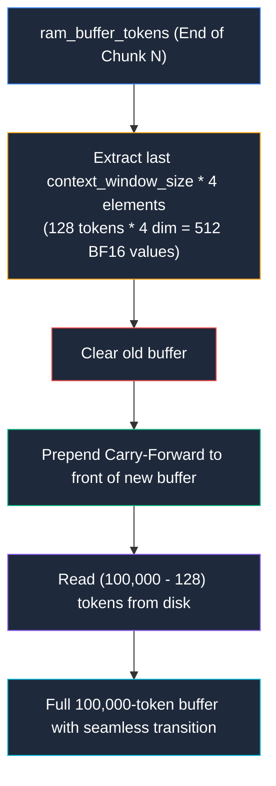

# AI Core: The "Life and Death" Data Synchronization Guarantee

```
Document Version : 3.0.0
Standard         : ISO/IEC 14882:2023 (C++23)
Classification   : Mission-Critical Architectural Specification
Subsystem        : Optimizer Data Pipeline, State Synchronization & GPU Bridge
Target           : Portion, GpuPortion, Optimizer::disk_to_ram, Optimizer::ram_to_contextWindow, class AI
```

---

## 1. Executive Summary & The "Million-Dollar" Analogy

In enterprise and frontier-grade deep learning, training state-of-the-art neural networks is an investment measured in hundreds of thousands to millions of dollars in compute, hardware cluster runtime, and energy consumption. 

The **Life and Death Guarantee** is the strict mathematical and architectural invariant governing how data transitions across the memory hierarchy: from persistent storage (**Tier 0: Disk**) to active host memory (**Tier 1: RAM Buffer**), into the model's perceptual field (**Tier 2: Context Window**), and finally across the PCIe bus into GPU VRAM (**Tier 3: Device Memory**).

```
+-----------------------------------------------------------------------------------------------+
|                               THE MULTI-TIER DATA PIPELINE                                    |
+-----------------------------------------------------------------------------------------------+
|                                                                                               |
|  [ TIER 0: Disk Storage ]  "database/embedded_data.bin" (8,289,605 tokens / 33,158,420 BF16)  |
|             │                                                                                 |
|             │ (Sequential Binary Chunk Stream — 100,000 tokens = 800 KB)                     |
|             ▼                                                                                 |
|  [ TIER 1: RAM Buffer ]    Portion::ram_buffer_tokens (Holds active working chunk + Seam)     |
|             │                                                                                 |
|             │ (Sliding Context Extraction — 128 tokens Input X, 1 token Target Y)             |
|             ▼                                                                                 |
|  [ TIER 2: Context Window] Portion::context_window_tokens (1 KB) & target_tokens (8 B)         |
|             │                                                                                 |
|             │ (PCIe Bus DMA Burst Transfer via upload_to_gpu() — cuda_transfer.dll)           |
|             ▼                                                                                 |
|  [ TIER 3: GPU Device VRAM] GpuPortion::d_context_window (1024 B) & d_target (8 B)            |
|             │                                                                                 |
|             │ (Forward Pass -> Loss Calculation -> Backpropagation -> Weight Update)          |
|             ▼                                                                                 |
|  [ AI NEURAL ENGINE ]      Learns parameters W and b via Tensor Cores (sm_89)                 |
|                                                                                               |
+-----------------------------------------------------------------------------------------------+
```

---

## 2. The Catastrophic Failure Modes: Why This Is "Life and Death"

If untrained, unprocessed tokens inside either the **RAM Buffer**, the **Context Window**, or **GPU VRAM** are prematurely cleared, overwritten, or desynchronized before the neural network consumes them, two fatal events occur:

### 2.1 Causal Sequence & Temporal Order Corruption
Foundation AI training relies on **autoregressive causality**: every token's meaning and prediction depend directly on the continuous, ordered history preceding it.
- Tokens are not independent data points; they represent a seamless multimodal tapestry of language, numbers, images, video frames, and audio waveforms.
- If a buffer is refreshed before its tail is trained, tokens are dropped mid-sequence.
- The neural network is suddenly forced to predict token $T_{k}$ from context that belongs to $T_{k - 50,000}$. The temporal continuity is shattered.

### 2.2 Catastrophic Weight Poisoning & Model Invalidation
In stochastic gradient descent (SGD) and momentum-based optimizers:
$$\theta_{t+1} = \theta_t - \eta \nabla_{\theta} \mathcal{L}(y, \hat{y})$$

- When a data sequence is corrupted or skips arbitrary blocks, the loss function experiences violent, non-stationary gradient explosions ($\nabla_{\theta} \mathcal{L} \rightarrow \infty$).
- These erratic gradient spikes permanently contaminate the internal weight matrices ($W$) and bias vectors ($b$).
- **The compounding disaster:** This does not simply ruin the current batch—it corrupts the accumulated mathematical representations learned across all prior weeks or months of training.
- **The consequence:** You cannot "patch" or "undo" poisoned weights. The entire checkpoint history becomes junk. The only remedy is a **hard reset to zero**: wipe all weights, discard the run, and start the multi-million-dollar training process from scratch.

---

## 3. The Synchronization Locks: Definition & Semantics

To make premature eviction mathematically impossible, `Portion` maintains explicit, non-bypassable hardware/software state locks:

```cpp
struct Portion {
  // Lock 1: Locks Tier 1 (RAM Buffer) while disk I/O or window extraction is executing
  bool buffer_in_use = false;

  // Lock 2: Locks Tier 2 (Context Window) while batch extraction or GPU training is active
  bool context_in_use = false;

  // Tier 1: The RAM Buffer (Disk -> RAM)
  size_t ram_buffer_size = 100000;
  std::vector<std::bfloat16_t> ram_buffer_tokens = {};

  // Tier 2: The AI's Field of View (RAM -> AI)
  size_t context_window_size = 128;
  std::vector<std::bfloat16_t> context_window_tokens = {};
  std::vector<std::bfloat16_t> target_tokens = {};
};
```

### 3.1 `buffer_in_use`
- **Owner:** `Optimizer::disk_to_ram` and `Optimizer::ram_to_contextWindow`.
- **Semantics:** Set to `true` the instant reading from disk begins; set to `false` only after the binary read and carry-forward operations are 100% complete and validated.
- **Rule:** While `buffer_in_use == true`, no thread or function may read from, slice, or clear `ram_buffer_tokens`.

### 3.2 `context_in_use`
- **Owner:** `Optimizer::ram_to_contextWindow` and the downstream training loop.
- **Semantics:** Set to `true` the instant batch extraction begins and remains `true` throughout the PCIe upload, Forward Pass, Loss Evaluation, and Backpropagation cycle.
- **Rule:** While `context_in_use == true`, the context window is immutable, and the feeder cannot advance to the next window.

---

## 4. Seam Preservation: The Carry-Forward Mechanism

When transitioning from one 100,000-token chunk to the next, a naive implementation would clear `ram_buffer_tokens` and load fresh data from disk. This creates a severe boundary failure known as **Seam Amnesia**: the tokens at the very end of chunk $N$ can never form a complete context window with the tokens at the beginning of chunk $N+1$.

`Optimizer::disk_to_ram()` solves this by enforcing the **Carry-Forward Protocol**:



Because `disk_to_ram()` owns the carry extraction and extracts the tail **before** clearing, `ram_to_contextWindow()` is strictly prohibited from clearing the buffer upon loop exit.

---

## 5. The Conductor Solution: Single-Threaded Sequential Order

To guarantee stability before transitioning to GPU/CUDA, **AI Core implements the Single-Threaded "Conductor" model**. The main training loop explicitly dictates execution sequentially:
1. Conductor tells the `Optimizer` to prepare one 128-token context window.
2. `Optimizer` carves out the data, locks the state, and immediately returns control to the Conductor.
3. Conductor calls `upload_to_gpu()` to mirror the data into GPU VRAM.
4. Conductor tells the `AI` to consume the data.
5. `AI` updates weights, clears the locks, and returns control.

This completely bypasses the spin-lock trap. Everything happens sequentially on the CPU, serving as the perfect, safe data delivery mechanism to push context windows over the PCIe bus to the GPU.

---

## 6. Summary Table: States and Permitted Operations

| `buffer_in_use` | `context_in_use` | RAM Buffer Status | Permitted Action | Prohibited Action |
| :---: | :---: | :---: | :--- | :--- |
| **`true`** | `false` | Loading from Disk | Complete disk read; resize buffer. | **NO** context window extraction; **NO** network feeding. |
| `false` | **`true`** | Populated | Feed $X$ and $Y$ to AI; backpropagate gradients. | **NO** buffer clearing; **NO** disk I/O; **NO** context rewriting. |
| `false` | `false` | Tokens Available | Call `ram_to_contextWindow()` to extract next sliding window. | **NO** `disk_to_ram()` (unprocessed tokens remain in RAM). |
| `false` | `false` | **Empty** (Exhausted) | Call `disk_to_ram()` with Carry-Forward seam preservation. | **NO** `ram_to_contextWindow()` (RAM has zero tokens). |
| **`true`** | **`true`** | **ILLEGAL STATE** | **FATAL SYSTEM ABORT** | Both active simultaneously indicates a race condition. |

---

## 7. Architectural Conclusion

The Life and Death Guarantee ensures that:
1. **Zero Tokens Lost:** Every single byte generated during multi-modal early fusion is ingested by the model in exact causal sequence.
2. **Zero Seam Discontinuity:** The Carry-Forward mechanism bridges chunk seams, preventing episodic amnesia.
3. **Hardware Capital Protection:** Model weights retain numerical stability, eliminating the risk of multi-million-dollar training corruption.
