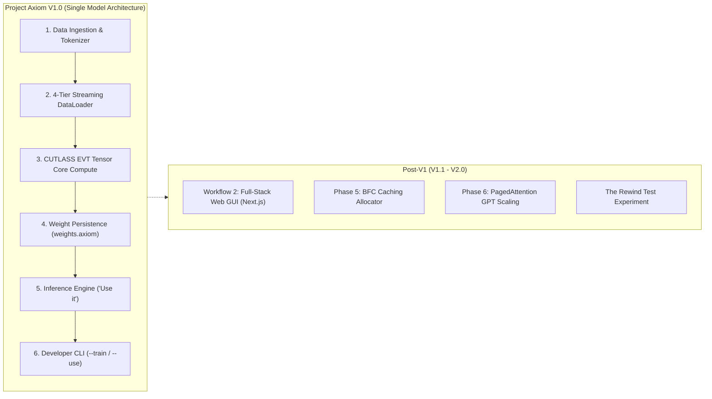

# 🗺️ Project Axiom: Path to Version 1.0 (V1)

> **Master Execution Blueprint, Milestone Audit & Engineering Roadmap to V1 Release**  
> *Target Architecture: C++23 • NVIDIA CUDA (Ada Lovelace sm_89) • CUTLASS v4.8.0*

---

## 1. Executive Summary & V1 Definition

### Current Project Status
- **Overall Completion:** **~70% – 75%**
- **Core Systems & Compute Engine:** **100% Complete & Validated (All 8 Test Suites Passing, 141 Tests 100% Green)**
- **Application Orchestration & Inference Pipeline:** **~40% Complete (Active Focus)**

The most complex, high-risk systems engineering hurdles—bare-metal CUDA kernel fusion, CUTLASS v4.8.0 Tensor Core saturation, PCIe DMA write-combined streaming, dual-stream ping-pong concurrency, FP32 master weights backpropagation, and the 4-tier Seam streaming data loader—are **fully functional and passing all test suites**.

### What Defines Version 1.0 (V1)?
**Version 1.0 represents the first fully autonomous, standalone release of Project Axiom.** 
It operationalizes the core philosophy outlined in [Features.md](Features.md):
1. **The Product Experience:** End users receive a pre-packaged, dedicated single model. They do not train or manage multi-model libraries; they simply run forward inference ("Use it") with zero Python dependencies.
2. **The Open-Source Contributor Experience:** Developers fork the repository, run the training pipeline (`--train`) on their own curated datasets, produce their own custom model weights (`weights.axiom`), and package releases.
3. **Simplicity First:** There are no runtime model registries, dynamic model switchers, or complex abstraction wrappers. It is **ONE unified model**.



---

## 2. Completed Foundations (Audit of Working Systems)

The foundational bedrock of Project Axiom is built, stable, and verified:

| Subsystem | Implementation Details | Status |
| :--- | :--- | :---: |
| **Dual-Compiler Toolchain** | NVCC + MSVC (`cl.exe`) for `.cu` device kernels, GCC 14 (`g++ -std=c++23`) for CPU logic, linking `cuda_transfer.dll`. | ✅ Complete |
| **Precision Architecture** | `std::bfloat16_t` (Brain Float) aligned with Ada Lovelace Tensor Cores, cutting VRAM by 75% vs FP64. | ✅ Complete |
| **Discrete Multimodal Space** | Orthogonal 10,000,000-slot token namespaces (Text, Numbers, Images, Video, Voice) preventing collisions. | ✅ Complete |
| **4-Tier Data Logistics** | NVMe (Tier 0) $\rightarrow$ RAM Buffer (Tier 1) $\rightarrow$ Pinned Memory (Tier 2) $\rightarrow$ GPU VRAM (Tier 3). | ✅ Complete |
| **"The Seam" Context Bridge** | 128-token carry-forward slicing across 100k-token buffers, eliminating historical amnesia at boundaries. | ✅ Complete |
| **PCIe Zero-Copy DMA** | `cudaHostAllocWriteCombined` pinned memory bypassing CPU L1/L2 caches for direct hardware DMA transfers. | ✅ Complete |
| **Ping-Pong Concurrency** | Dual non-blocking streams (`cudaStreamNonBlocking`) overlapping PCIe memory transfers with Tensor Core compute. | ✅ Complete |
| **CUTLASS EVT Saturation** | `mma.sync.aligned.m16n8k16` Tensor Core GEMM fused with bias addition and ReLU in shared memory (0 VRAM round-trips). | ✅ Complete |
| **SGD Backpropagation** | Custom `backward_pass_kernel` updating FP32 master weights with SGD, in-place BF16 rounding, and atomic loss accumulation. | ✅ Complete |
| **Automated Verification** | 141 comprehensive test cases across Path, Stream, Embedding, Tokenization, Optimizer, Transfer, AI, and EVT Gradients (100% Green). | ✅ Complete |

---

## 3. The Critical Path to V1: Remaining Sprints

To graduate from a working technical prototype to the official **V1.0 Release**, the following 3 focused sprints must be executed:

```
V1.0 Critical Path:
Sprint 1: Single Model Weight Persistence (weights.axiom)
    └── Sprint 2: Inference Engine ("Use it" Forward Pass)
            └── Sprint 3: Release Packaging & Verification
```

---

### 🏃 Sprint 1: Single Model Weight Persistence (Save & Load)
*Objective: Persist trained neural parameters to disk (`weights.axiom`) and load them directly on startup.*

#### The Problem
Currently, weights exist in volatile host memory (`h_weights`, `h_bias`) and GPU VRAM during process execution. Exiting `app.exe` destroys all trained parameters unless saved.

#### Technical Deliverables
1. **Direct Binary Weight Serialization (`weights.axiom`):**
   - Clean, lightweight binary file format:
     ```text
     [Magic Header: "AXIOM_V1"]
     [uint64_t: in_dim (512)]
     [uint64_t: out_dim (4)]
     [uint64_t: weight_count] -> Raw FP32 weights
     [uint64_t: bias_count]   -> Raw FP32 biases
     ```
2. **Implementation in `AI` (`core/src/ai.cpp` & `core/include/ai.hpp`):**
   - `bool AI::save_weights(const std::string& path = "weights.axiom");`
     - Downloads latest master weights from GPU via `download_weights_from_gpu()`.
     - Flushes binary buffer directly to disk.
   - `bool AI::load_weights(const std::string& path = "weights.axiom");`
     - Reads binary payload into `h_weights` and `h_bias`.
     - Uploads directly into GPU VRAM via `upload_weights_to_gpu()`.
3. **Unit Tests:**
   - Round-trip verification: Train $\rightarrow$ Save $\rightarrow$ Reset to chaos $\rightarrow$ Load $\rightarrow$ Assert weights match bit-for-bit.

---

### 🏃 Sprint 2: Inference Engine ("Use it")
*Objective: Activate menu option `[1] Use it` to run forward prediction without backward gradient passes.*

#### The Problem
In `core/src/main.cpp`, selecting `[1] Use it` prints `[!] 'Use it' is not available yet.` The model can train, but cannot be prompted to generate outputs.

#### Technical Deliverables
1. **Inference Forward Pass Method:**
   - Implement `AI::predict(const Portion& portion, std::vector<float>& output_prediction);`
   - Executes the CUTLASS EVT forward pass on Stream 0 without triggering the SGD backward kernel or updating weights.
   - Downloads device activations (`d_output`) back to host RAM.
2. **Tokenizer Decoding / Output Mapper:**
   - Take the 4-dimensional predicted embedding $Y \in \mathbb{R}^{1 \times 4}$.
   - Find the nearest neighbor in the token embedding space or map the continuous prediction back to discrete categorical outputs.
3. **Interactive Inference Prompt in `main.cpp`:**
   - Allow user to provide inputs.
   - Run forward pass and stream predictions to the console in real time.

---

### 🏃 Sprint 3: V1 Release Packaging & Verification
*Objective: Finalize CLI ergonomic flags (`--use`, `--train`, `--test`), verify end-to-end workflows, and package V1.0.*

#### Technical Deliverables
1. **CLI Arguments & Ergonomics:**
   - Default / `app.exe --use`: Launch direct inference for end users with pre-loaded `weights.axiom`.
   - `app.exe --train`: Launch continuous training loop for developers / open-source contributors on custom data.
   - `app.exe --test`: Run the automated verification suite.
2. **End-to-End Workflow Verification:**
   - Automated verification covering: Train on sample data $\rightarrow$ Save `weights.axiom` $\rightarrow$ Run `--use` inference.
3. **Release Artifacts:**
   - Pre-compiled production binaries (`app.exe`, `cuda_transfer.dll`).
   - Clean user manual and Quickstart Guide in `README.md`.

---

## 4. Workflows & Post-V1 Scope (V1.1 – V2.0)

To guarantee a fast, disciplined V1.0 launch, the project scope is clearly segmented into **V1.0 Core** vs. **Post-V1 Scale**:

```
┌────────────────────────────────────────────────────────┐
│                   AXIOM VERSION 1.0                    │
│   • Single Dedicated Model Architecture                │
│   • End-User Inference Engine ("Use it")               │
│   • Developer Training Pipeline (--train)              │
│   • Binary Weight Persistence (weights.axiom)          │
│   • 141 Tests Passing • Standalone Executables         │
└───────────────────────────┬────────────────────────────┘
                            │
                            ▼
┌────────────────────────────────────────────────────────┐
│                   AXIOM VERSION 1.1                    │
│   • Workflow 2: Next.js Frontend + Backend API         │
│   • Visual Real-Time Loss Curves in Browser            │
│   • Web-Based Media & Data Uploads                     │
└───────────────────────────┬────────────────────────────┘
                            │
                            ▼
┌────────────────────────────────────────────────────────┐
│                   AXIOM VERSION 2.0                    │
│   • Phase 5: BFC Userspace Caching Allocator           │
│   • Phase 6: PagedAttention KV-Cache GPT Scaling       │
│   • Phase 7: CUDA Graphs & ATen Dispatcher             │
│   • The Rewind Test on Hardware Entropy                │
└────────────────────────────────────────────────────────┘
```

---

## 5. Master Action Checklist to V1.0

### Phase A: Persistence
- [x] Implement `AI::save_weights()` in `core/src/ai.cpp`
- [x] Implement `AI::load_weights()` in `core/src/ai.cpp`
- [x] Add unit test for weight serialization round-trip in `core/test/test_ai.cpp`

### Phase B: Inference & Interactive Loop
- [ ] Implement forward-only inference method in `ai.cpp`
- [ ] Implement token decoding to map continuous embeddings to discrete outputs
- [ ] Hook option `[1] Use it` in `main.cpp`
- [ ] Build interactive prompt for inference

### Phase C: CLI Polish & Release
- [ ] Enable CLI flags (`--use`, `--train`, `--test`)
- [ ] Verify live end-to-end user manual test
- [ ] Tag `v1.0.0` on GitHub and publish announcement
