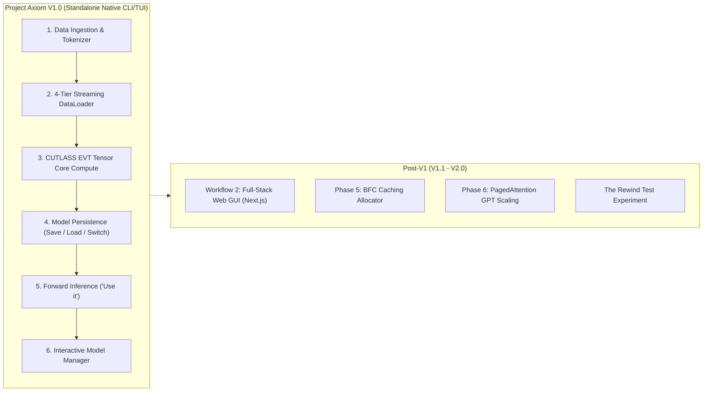

# 🗺️ Project Axiom: Path to Version 1.0 (V1)

> **Master Execution Blueprint, Milestone Audit & Engineering Roadmap to V1 Release**  
> *Target Architecture: C++23 • NVIDIA CUDA (Ada Lovelace sm_89) • CUTLASS v4.8.0*

---

## 1. Executive Summary & V1 Definition

### Current Project Status
- **Overall Completion:** **~60% – 65%**
- **Core Systems & Compute Engine:** **100% Complete & Validated (78 Automated Tests Passing)**
- **Application Orchestration & Persistence:** **~30% Complete (Active Focus)**

The most complex, high-risk systems engineering hurdles—bare-metal CUDA kernel fusion, CUTLASS v4.8.0 Tensor Core saturation, PCIe DMA write-combined streaming, dual-stream ping-pong concurrency, FP32 master weights backpropagation, and the 4-tier Seam streaming data loader—are **fully functional and passing all test suites**.

### What Defines Version 1.0 (V1)?
**Version 1.0 represents the first fully autonomous, standalone release of Project Axiom.** 
It operationalizes the core philosophy outlined in [Features.md](file:///c:/Users/Omid/X/Code/PROJECT-AXIOM/document/Features.md): a user can train an AI locally on handpicked data, name and save the model to disk, switch between models, retrain them, run forward inference ("Use it"), or hard-reset all weights in seconds—with zero Python runtime dependencies.



---

## 2. Completed Foundations (Audit of Working Systems)

The foundational bedrock of Project Axiom is built, stable, and verified:

| Subsystem | Implementation Details | Status |
| :--- | :--- | :---: |
| **Dual-Compiler Toolchain** | NVCC + MSVC (`cl.exe`) for `.cu` device kernels, GCC 14 (`g++ -std=c++23`) for CPU logic, linking `cuda_transfer.dll`. | ✅ Complete |
| **Precision Architecture** | `std::bfloat16_t` (Brain Float) aligned with Ada Lovelace Tensor Cores, cutting VRAM by 75% vs FP64. | ✅ Complete |
| **Discrete Multimodal Space** | Orthogonal 10,000,000-slot token namespaces (Text, Numbers, Images, Video, Voice) preventing collisions. | ✅ Complete |
| **4-Tier Data Logistics** | NVMe (Tier 0) $\rightarrow$ RAM Buffer (Tier 1) $\rightarrow$ Pinned Memory (Tier 2) $\rightarrow$ GPU VRAM (Tier 3). | ✅ Complete |
| **"The Seam" Context Bridge** | 128-token carry-forward slicing across 100k-token buffers, eliminating historical amnesia at boundaries. | ✅ Complete |
| **PCIe Zero-Copy DMA** | `cudaHostAllocWriteCombined` pinned memory bypassing CPU L1/L2 caches for direct hardware DMA transfers. | ✅ Complete |
| **Ping-Pong Concurrency** | Dual non-blocking streams (`cudaStreamNonBlocking`) overlapping PCIe memory transfers with Tensor Core compute. | ✅ Complete |
| **CUTLASS EVT Saturation** | `mma.sync.aligned.m16n8k16` Tensor Core GEMM fused with bias addition and ReLU in shared memory (0 VRAM round-trips). | ✅ Complete |
| **SGD Backpropagation** | Custom `backward_pass_kernel` updating FP32 master weights with SGD, in-place BF16 rounding, and atomic loss accumulation. | ✅ Complete |
| **Automated Verification** | 78 comprehensive test cases across Optimizer, Tokenizer, Embeddings, CUDA Transfers, and EVT Gradients. | ✅ Complete |

---

## 3. The Critical Path to V1: Remaining Sprints

To graduate from a working technical prototype to the official **V1.0 Release**, the following 4 focused sprints must be executed:

```
V1.0 Critical Path:
Sprint 1: Model Disk Serialization (Save & Load)
    └── Sprint 2: Inference Engine ("Use it")
            └── Sprint 3: Interactive Model Registry & Switching
                    └── Sprint 4: Release Packaging & Verification
```

---

### 🏃 Sprint 1: Model Persistence & Disk Serialization (Save & Load)
*Objective: Transform volatile VRAM/RAM weights into persistent, named models on disk.*

#### The Problem
Weights currently live only in volatile host memory (`h_weights`, `h_bias`) and GPU VRAM during process execution. Exiting `app.exe` destroys all trained parameters.

#### Technical Deliverables
1. **Binary Model Format (`.axiom` / `.bin`):**
   - Design a compact, header-validated binary serialization format:
     ```text
     [Magic Header: "AXIOM_MODEL_V1"]
     [uint32_t: in_dim (512)]
     [uint32_t: out_dim (4)]
     [float: learning_rate]
     [uint64_t: total_training_steps]
     [uint64_t: weight_bytes] -> Raw FP32/BF16 weights payload
     [uint64_t: bias_bytes]   -> Raw FP32/BF16 bias payload
     [uint32_t: vocab_size]   -> Token vocabulary / hash table
     ```
2. **Implementation in [core/src/ai.cpp](file:///c:/Users/Omid/X/Code/PROJECT-AXIOM/core/src/ai.cpp) & [core/include/ai.hpp](file:///c:/Users/Omid/X/Code/PROJECT-AXIOM/core/include/ai.hpp):**
   - `bool AI::save_model(const std::string& model_name, const std::string& directory = "database/models");`
     - Downloads latest weights from GPU via `download_weights_from_gpu()`.
     - Serializes metadata, weights, and biases to `database/models/<model_name>.axiom`.
   - `bool AI::load_model(const std::string& filepath);`
     - Reads binary payload from disk into `h_weights` and `h_bias`.
     - Uploads directly into GPU VRAM via `upload_weights_to_gpu()`.
3. **Unit Tests:**
   - Round-trip test: Initialize $\rightarrow$ Train 100 steps $\rightarrow$ Save $\rightarrow$ Reset to chaos $\rightarrow$ Load $\rightarrow$ Assert weights match exactly.

---

### 🏃 Sprint 2: Inference Engine ("Use it")
*Objective: Activate menu option `[1] Use it` to run forward prediction without backward gradient passes.*

#### The Problem
In [core/src/main.cpp](file:///c:/Users/Omid/X/Code/PROJECT-AXIOM/core/src/main.cpp#L183-L187), selecting `[1] Use it` prints `[!] 'Use it' is not available yet.` The model can train, but cannot be prompted to generate outputs.

#### Technical Deliverables
1. **Inference Forward Pass Method:**
   - Implement `AI::predict(const Portion& portion, std::vector<float>& output_prediction);`
   - Executes the CUTLASS EVT forward pass on Stream 0 without triggering the SGD backward kernel or updating weights.
   - Downloads device activations (`d_output`) back to host RAM.
2. **Tokenizer Decoding / Output Mapper:**
   - Take the 4-dimensional predicted embedding $Y \in \mathbb{R}^{1 \times 4}$.
   - Find the nearest neighbor in the token embedding space or map the continuous prediction back to categorical text/token outputs.
3. **Interactive Inference Prompt in `main.cpp`:**
   - Allow user to type text or supply inputs.
   - Run forward pass and stream predictions to the console in real time.

---

### 🏃 Sprint 3: Interactive Model Registry & Seamless Model Switching
*Objective: Operationalize the philosophy of maintaining a library of named models (`cat_video_ai`, `coding_ai`).*

#### The Problem
There is currently no user interface for creating named models, listing existing saved models, or switching between models without terminating the process.

#### Technical Deliverables
1. **Model Directory Manager:**
   - Scan `database/models/` for all `.axiom` files.
   - Display a model management menu in `main.cpp`:
     ```text
     =======================================
               AXIOM MODEL MANAGER          
     =======================================
     Active Model: [cat_video_ai] (Steps: 45,000 | Loss: 0.0084)
     
     [1] Train active model
     [2] Use active model (Inference)
     [3] Switch / Load another model
     [4] Create new model from scratch
     [5] Hard reset active model weights
     [6] Export / Save active model
     [0] Exit
     ```
2. **Seamless In-Memory Model Switching:**
   - When switching models: download/save current model $\rightarrow$ free device memory $\rightarrow$ load selected model from disk $\rightarrow$ upload to VRAM $\rightarrow$ resume immediately.
   - Supports the user's workflow: *"Tired of image model? Switch back to cat model, train it a bit more, and use it."*

---

### 🏃 Sprint 4: Media Ingestion & Parser Hardening
*Objective: Remove placeholder stubs for media and harden multimodal input parsing.*

#### Technical Deliverables
1. **Activate Media Pairing in `main.cpp`:**
   - Remove `[!] Adding media is not available yet` stub.
   - Allow user input combining text and file paths to images (`.jpeg`, `.png`), video (`.mp4`), and audio (`.ogg`, `.wav`).
2. **Byte / Tokenizer Ingestion:**
   - Verify byte tokenization for media files into their respective 10,000,000-slot namespaces.

---

### 🏃 Sprint 5: V1 Verification, Benchmarks & Release Packaging
*Objective: Build production binaries, verify end-to-end user workflows, and package V1.0.*

#### Technical Deliverables
1. **End-to-End Workflow Verification:**
   - Script automated verification covering: Create $\rightarrow$ Train on sample data $\rightarrow$ Save as `test_model.axiom` $\rightarrow$ Hard reset $\rightarrow$ Verify loss jumps $\rightarrow$ Reload `test_model.axiom` $\rightarrow$ Verify loss restores $\rightarrow$ Run inference.
2. **CLI Arguments & Ergonomics:**
   - `app.exe --train --model cat_video_ai`
   - `app.exe --use --model cat_video_ai`
   - `app.exe --list-models`
   - `app.exe --test`
3. **Release Artifacts:**
   - Pre-compiled production binaries (`app.exe`, `cuda_transfer.dll`, `test.exe`).
   - Clean user manual and Quickstart Guide in `README.md`.

---

## 4. Workflows & Post-V1 Scope (V1.1 – V2.0)

To guarantee a fast, disciplined V1.0 launch, the project scope is clearly segmented into **V1.0 Core** vs. **Post-V1 Scale**:

```
┌────────────────────────────────────────────────────────┐
│                   AXIOM VERSION 1.0                    │
│   • Workflow 1: Native C++23 / CUDA CLI/TUI            │
│   • Model Persistence (Save / Load / Switch)           │
│   • Inference Engine ("Use it")                        │
│   • Curated Handpicked Data Training                   │
│   • 78 Tests Passing • Standalone Executables          │
└───────────────────────────┬────────────────────────────┘
                            │
                            ▼
┌────────────────────────────────────────────────────────┐
│                   AXIOM VERSION 1.1                    │
│   • Workflow 2: Next.js Frontend + Backend API         │
│   • Visual Real-Time Loss Curves in Browser            │
│   • Web-Based Model Switching & Media Uploads          │
└───────────────────────────┬────────────────────────────┘
                            │
                            ▼
┌────────────────────────────────────────────────────────┐
│                   AXIOM VERSION 2.0                    │
│   • Phase 5: BFC Userspace Caching Allocator           │
│   • Phase 6: PagedAttention KV-Cache GPT Scaling       │
│   • Phase 7: CUDA Graphs & ATen Dispatcher             │
│   • The Rewind Test on Hardware Entropy                │
└────────────────────────────────────────────────────────┘
```

---

## 5. Master Action Checklist to V1.0

### Phase A: Persistence & Model Registry
- [ ] Add `.axiom` binary header format specification
- [ ] Implement `AI::save_model()` in `ai.cpp`
- [ ] Implement `AI::load_model()` in `ai.cpp`
- [ ] Implement model listing in `database/models/`
- [ ] Add unit test for model serialization round-trip

### Phase B: Inference & Interactive Loop
- [ ] Implement forward-only inference method in `ai.cpp`
- [ ] Implement token decoding to map continuous embeddings to discrete outputs
- [ ] Hook option `[1] Use it` in `main.cpp`
- [ ] Build interactive prompt for inference

### Phase C: Model Switching & CLI Polish
- [ ] Build interactive Model Manager menu in `main.cpp`
- [ ] Wire seamless in-memory model switching
- [ ] Enable CLI flags (`--train`, `--use`, `--model <name>`, `--list`)
- [ ] Remove `Add media` stub and wire multimodal file paths

### Phase D: Final Testing & Release
- [ ] Run full 78+ automated tests including persistence tests
- [ ] Perform live end-to-end user manual test
- [ ] Tag `v1.0.0` on GitHub and publish announcement
