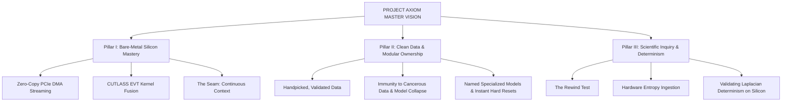

# Comprehensive Summary & Master Synthesis of Project Axiom Documentation

> **Master Technical Digest & Architectural Compendium**  
> *Compiled from all foundational, philosophical, mathematical, and implementation documents across the Project Axiom repository.*

---

## Table of Contents
1. [Executive Overview: What is Project Axiom?](#1-executive-overview-what-is-project-axiom)
2. [Document-by-Document Summaries](#2-document-by-document-summaries)
   - [2.1 `README.md` — Master Architecture, Telemetry & Technical Specification](#21-readmemd--master-architecture-telemetry--technical-specification)
   - [2.2 `document/Features.md` — Core Philosophy, Modular Models & Workflows](#22-documentfeaturesmd--core-philosophy-modular-models--workflows)
   - [2.3 `document/optimizer_analogy.md` — The Library, The Book, and The Page](#23-documentoptimizer_analogymd--the-library-the-book-and-the-page)
   - [2.4 `document/demonstration_analogy_readme.md` — Sliding Window Mathematical Trace](#24-documentdemonstration_analogy_readmemd--sliding-window-mathematical-trace)
   - [2.5 `document/plan/data.md` — Forensic Technical Review & Scaling Roadmap](#25-documentplandatamd--forensic-technical-review--scaling-roadmap)
   - [2.6 `document/plan/polished_plan.md` — The "Zero to Hero" 7-Phase Execution Blueprint](#26-documentplanpolished_planmd--the-zero-to-hero-7-phase-execution-blueprint)
   - [2.7 `document/learn/Artificial Intelligence & Neural Network Mechanics.md` — Systems & Hardware Primer](#27-documentlearnartificial-intelligence--neural-network-mechanicsmd--systems--hardware-primer)
   - [2.8 `document/research_hypotheses.md` — The Rewind Test, Computational Determinism & Cancerous Data](#28-documentresearch_hypothesesmd--the-rewind-test-computational-determinism--cancerous-data)
   - [2.9 `document/probability_integration_plan.md` — Hardware Entropy Pipeline & Empirical Determinism](#29-documentprobability_integration_planmd--hardware-entropy-pipeline--empirical-determinism)
3. [Cross-Document Technical Comparison & Pipeline Matrix](#3-cross-document-technical-comparison--pipeline-matrix)
4. [Master Conclusion & Unified Vision](#4-master-conclusion--unified-vision)

---

## 1. Executive Overview: What is Project Axiom?

**Project Axiom** is a ground-up rewrite of deep learning mechanics engineered strictly in **C++23** and **NVIDIA CUDA**. It rejects the prevailing industry paradigm of heavy, abstracted Python frameworks (PyTorch, TensorFlow, JAX), garbage collection overhead, non-deterministic runtimes, and indiscriminate web scraping.

Instead, Axiom establishes:
- **Silicon-Native Control:** Exact byte-layout mastery in host RAM and GPU VRAM.
- **Hardware-Native Saturation:** 100% Tensor Core utilization on NVIDIA Ada Lovelace (`sm_89`, RTX 40-series) via CUTLASS v4.8.0 templates and Epilogue Visitor Trees (EVT).
- **Zero-Latency Data Logistics:** PCIe DMA streaming utilizing pinned write-combined memory and asynchronous ping-pong multi-stream buffering.
- **Continuous Learning without Amnesia:** "The Seam" carry-forward sliding window bridging chunk boundaries.
- **Modular Model Ownership:** Training specialized, handpicked models that can be named, saved, swapped, retrained, or hard-reset at will.
- **Empirical Scientific Inquiry:** The Rewind Test to examine computational and physical determinism by training neural networks on hardware entropy.

---

## 2. Document-by-Document Summaries

### 2.1 `README.md` — Master Architecture, Telemetry & Technical Specification
*Location: [README.md](file:///c:/Users/Omid/X/Code/PROJECT-AXIOM/README.md)*

The master README serves as the definitive technical specification and operational manual for Project Axiom.

#### Key Highlights & Architecture
1. **The Rejection of Framework Bloat:**
   - Highlights the 4 major flaws of standard AI stacks: garbage collection pauses, CPU-to-driver interpreter latency, severe VRAM memory fragmentation, and uncurated data thrashing.
   - Declares Axiom's philosophy: bare-metal silicon control, local offline execution, and total hardware saturation.

2. **The 4-Tier Synchronized Memory Conveyor Belt:**
   - **Tier 0 (NVMe Disk):** Raw binary stream (`embedded_data.bin`).
   - **Tier 1 (Host System RAM):** 100,000-token ($400,000$ `bfloat16` elements) persistent buffer managed via `std::ifstream`, featuring "The Seam" carry-forward mechanism.
   - **Tier 2 (Pinned Host RAM):** Dual write-combined buffers (`cudaHostAllocWriteCombined`) for direct PCIe Direct Memory Access (DMA), bypassing CPU L1/L2 caches and accelerating bus throughput by up to 40%.
   - **Tier 3 (GPU VRAM & Ada Lovelace sm_89 Compute):** Non-blocking dual CUDA streams executing fused CUTLASS EVT kernels and Rank-1 SGD backpropagation.

3. **Core Engineering Innovations:**
   - **Discrete VQ-VAE Multimodal Space:** Isolates token IDs across orthogonal 10,000,000-element offsets (Text: 1–9.99M, Numbers: 10M–19.99M, Images: 20M–29.99M, Video: 30M–39.99M, Voice: 40M–49.99M) so modalities never collide.
   - **The Seam (Carry-Forward):** Surgically preserves the last 128 context tokens across chunk boundaries to eliminate historical amnesia.
   - **Ping-Pong Streaming:** Stream 0 computes while Stream 1 transfers data across PCIe asynchronously, eliminating GPU idle time.
   - **CUTLASS v4.8.0 & EVT Kernel Fusion:** Dispatches `mma.sync.aligned.m16n8k16` instructions on Tensor Cores, fusing GEMM, bias addition, and ReLU activation into shared memory registers with zero intermediate VRAM round-trips.
   - **High-Precision Master Weights:** Maintains FP32 master weights (`d_weights_master`, `d_bias_master`) to prevent gradient underflow in `bfloat16`, rounding down in-place after SGD updates.

4. **Mathematical Nucleus & Convergence Safety:**
   - Evaluates autoregressive next-token prediction over $128 \times 4 = 512$ inputs.
   - Defines spectral norm bound for learning rate stability: $\eta_{\max} = \frac{2}{\|X\|_2^2 + 1}$. With $\|X\|_2^2 \approx 50$, $\eta > 0.04$ causes divergence; Axiom sets $\eta = 0.001$ for monotonic descent.

5. **Defensive Engineering & Verification:**
   - Strict 3-step pointer lifecycle: **Null Guard $\rightarrow$ Free $\rightarrow$ Neutralize**.
   - Clean dynamic link library export (`cuda_transfer.dll`) via `extern "C"` with opaque pointers, completely decoupling the C++23 CPU application from CUDA/MSVC headers.
   - Includes real-time hardware telemetry and 78 automated passing test suites.

---

### 2.2 `document/Features.md` — Core Philosophy, Modular Models & Workflows
*Location: [document/Features.md](file:///c:/Users/Omid/X/Code/PROJECT-AXIOM/document/Features.md)*

This document details the project's human-centric engineering philosophy, core features, and architectural workflows.

#### Key Highlights
1. **The Secret of Deep Learning:**
   - Demystifies AI: AI is not magic; it is millions or billions of mathematical weights adjusted to data. If weights merely reflect input data, feeding uncurated internet sludge is fundamentally defective.
   - Axiom strips away Python bloat and garbage collection to achieve direct byte layout control and 100% Tensor Core saturation.

2. **Core Feature Set:**
   - **Mathematical Symmetry Breaking:** Uses `std::mt19937` (Mersenne Twister) to inject uniform random chaos into VRAM at initialization, preventing the "clone army" failure where neurons learn identical features.
   - **The Seam:** 128-token boundary slice preserving continuous consciousness.
   - **Zero-Latency Streaming:** Write-combined pinned memory and async ping-pong buffering.
   - **True Native Multimodality:** Discrete VQ-VAE mathematical coordinate space.
   - **Production-Ready Memory Defense:** Strict neutralize lifecycle and `std::atomic<bool>` sequentially consistent memory barriers.
   - **Local Sandbox with Web Ingestion:** Runs 100% offline, with an optional module to connect, crawl, train, disconnect, and run locally again.

3. **The Single-Model Architecture & Open-Source Workflow:**
   - AI performs best when trained specifically on **handpicked, validated data** tailored to a precise goal.
   - **End-User Experience:** Normal end-users run the pre-trained, dedicated model directly for instant zero-friction inference ("Use it") without training overhead.
   - **Developer Experience:** Open-source contributors fork the repository, run the training loop (`--train`) on their own data, produce custom releases, or hit 'R' to hard-reset weights in seconds.
   - No runtime model registries or multi-model switching overhead: pure simplicity with **one dedicated neural model**.

4. **Dual Workflows:**
   - **Workflow 1:** Pure CUDA / C++ native UI/UX.
   - **Workflow 2:** CUDA / C++ high-performance backend coupled with a modern React, TypeScript, and Tailwind frontend.

---

### 2.3 `document/optimizer_analogy.md` — The Library, The Book, and The Page
*Location: [document/optimizer_analogy.md](file:///c:/Users/Omid/X/Code/PROJECT-AXIOM/document/optimizer_analogy.md)*

A concise conceptual document providing an intuitive mental model for Axiom's 4-tier data pipeline:

| Component | Physical Hardware | Analogy Mapping & Function |
| :--- | :--- | :--- |
| **The Library** | NVMe Hard Drive (Disk) | Contains the entire vast collection of multimodal data; too massive to read all at once. |
| **The Book** | Host System RAM Buffer | Pulling one manageable 100,000-token chunk from the library and placing it on the desk. |
| **The Page** | Context Window | Reading exactly 128 tokens (512 `bfloat16` elements) at a time and handing it to the AI. |
| **Ripping the Last Page Out** | The Carry-Forward (The Seam) | Ripping the final 128 tokens from the finished book and stapling them to the front of the next book before discarding the old one, guaranteeing the narrative is never severed. |

---

### 2.4 `document/demonstration_analogy_readme.md` — Sliding Window Mathematical Trace
*Location: [document/demonstration_analogy_readme.md](file:///c:/Users/Omid/X/Code/PROJECT-AXIOM/document/demonstration_analogy_readme.md)*

An exact numerical walk-through of the sliding window extraction algorithm within a single 100,000-token RAM buffer:

#### Numerical Parameters
- Buffer capacity: $100,000\text{ tokens} \times 4\text{ dimensions} = 400,000\text{ elements}$.
- Context window: $128\text{ tokens} \times 4 = 512\text{ elements}$.
- Target prediction: $1\text{ token} \times 4 = 4\text{ elements}$.
- Total elements required per extraction: $512 + 4 = 516\text{ elements}$.
- Step stride: `offset += 4` (advancing by 1 token / 4 elements per step).

#### Step Execution Trace
- **Step 1 (First Window):**
  - Check: $0 + 516 \le 400,000$ (True).
  - Context: indices `0..511`; Target: indices `512..515`; New offset: `4`.
- **Step 2 (Second Window):**
  - Check: $4 + 516 \le 400,000$ (True).
  - Context: indices `4..515`; Target: indices `516..519`; New offset: `8`.
- **Step 3 (Third Window):**
  - Check: $8 + 516 \le 400,000$ (True).
  - Context: indices `8..519`; Target: indices `520..523`; New offset: `12`.
- *(Repeats identically for 99,868 iterations)*
- **Step 99,872 (Final Window in Buffer):**
  - Check: $399,484 + 516 = 400,000 \le 400,000$ (True - Perfect Hit).
  - Context: indices `399,484..399,995`; Target: indices `399,996..399,999`; New offset: `399,488`.
- **Step 99,873 (End of Book):**
  - Check: $399,488 + 516 = 400,004 \le 400,000$ (False).
  - Returns `false`, triggering buffer reload and Seam carry-forward.

---

### 2.5 `document/plan/data.md` — Forensic Technical Review & Scaling Roadmap
*Location: [document/plan/data.md](file:///c:/Users/Omid/X/Code/PROJECT-AXIOM/document/plan/data.md)*

An exhaustive, deep technical systems review analyzing triumphs, concurrency liabilities, and the path to industry-grade performance.

#### Forensic Analysis & Findings
1. **Architectural Triumphs:**
   - Replacing `double` with `uint32_t` token IDs eliminates mantissa degradation in categorical hashes.
   - Orthogonal 10,000,000-slot namespace separation prevents cross-modal embedding collisions.
   - Refactoring from 64-bit float to 16-bit `std::bfloat16_t` matches Ada Lovelace (`sm_89`) / Hopper (`sm_90`) Tensor Core expectations and slashes memory bandwidth by 75% compared to FP64.
   - Two-tier streaming data loader with carry-forward resolves Out-Of-Memory limits.

2. **Critical Liabilities Diagnosed:**
   - **The Spin-Lock Trap:** Using `while (training_in_use)` creates an infinite deadlock in single-threaded runs, causes torn reads without memory barriers in multi-threaded runs, and wastes CPU power by pinning cores at 100%.
   - **Buffer Clearing Hazards:** Calling `.clear()` prematurely destroyed data required for carry-forward logic, exposing an undisciplined ownership model.
   - **Pageable Memory Fallback:** Pushing `std::vector` to the GPU via `cudaMemcpyAsync` silently degrades into synchronous, blocking transfers because the OS cannot grant Direct Memory Access on pageable heap memory.

3. **The 7 Engineering Progression Phases:**
   - **Phase I (PCIe Zero-Copy):** Replace `std::vector` with `cudaHostAllocWriteCombined` pinned memory to bypass CPU caches and unlock hardware DMA.
   - **Phase II (Concurrency & Streams):** Eliminate spin-locks using lock-free Single-Producer Single-Consumer (SPSC) ring buffers with `std::atomic` acquire/release semantics; implement ping-pong double buffering over non-blocking CUDA streams.
   - **Phase III (Tensor Core Saturation):** Replace naive nested loops with CUTLASS v4.8.0 templates and Epilogue Visitor Trees (EVT) to fuse GEMM + Bias + ReLU in shared memory registers.
   - **Phase IV (Advanced VRAM Management):** Transition from blocking `cudaMalloc` to stream-ordered allocators (`cudaMemPool_t`, `cudaMallocAsync`), progressing to a userspace PyTorch-style Best-Fit with Coalescing (BFC) allocator.
   - **Phase V (PagedAttention):** Implement an OS-style page table for KV caches, chunking memory into 16-token physical blocks to eliminate internal/external fragmentation and enable Copy-On-Write (COW) prompt caching.
   - **Phase VI (CUDA Graphs):** Record iterations into Directed Acyclic Graphs via `cudaStreamBeginCapture`, offloading scheduling to the GPU and eradicating CPU kernel launch overhead.
   - **Phase VII (ATen-Style Dispatcher):** Decouple `Tensor` handles from `TensorImpl` data storage, routing operations through a C++ Dispatcher based on `DispatchKeySet` (CPU, CUDA, Autograd).

---

### 2.6 `document/plan/polished_plan.md` — The "Zero to Hero" 7-Phase Execution Blueprint
*Location: [document/plan/polished_plan.md](file:///c:/Users/Omid/X/Code/PROJECT-AXIOM/document/plan/polished_plan.md)*

A distilled, executive-level version of the roadmap dividing development into distinct, actionable engineering phases:

- **Phase 1: Foundational Architecture & Precision Scaling (Completed):** 4-tier logistics, `uint32_t` tokens, 10M modal offsets, `std::bfloat16_t` conversion.
- **Phase 2: Asynchronous Data Logistics & The Seam (Completed):** Persistent `std::ifstream`, carry-forward seam, SPSC lock-free concurrency.
- **Phase 3: PCIe Zero-Copy Pipeline & CUDA Integration (Completed):** NVCC/MSVC/GCC toolchain, `cudaHostAllocWriteCombined`, dual-stream ping-pong buffering.
- **Phase 4: The Neural Nucleus & Hardware Compute (Completed):** Weight initialization with symmetry breaking, CUTLASS v4.8.0 GEMM, Epilogue Visitor Trees (EVT), FP32 master weights SGD backpropagation.
- **Phase 5: Production VRAM Management (Queued):** Stream-ordered memory pools (`cudaMemPool_t`), custom userspace BFC caching allocator.
- **Phase 6: Autoregressive State Management / GPT-Scale (Queued):** PagedAttention block tables, Copy-On-Write (COW) prefix caching.
- **Phase 7: Microsecond Overhead & Framework Modularity (Queued):** CUDA Graph DAG capture (`cudaGraphLaunch`), ATen-style declarative operator dispatcher.

---

### 2.7 `document/learn/Artificial Intelligence & Neural Network Mechanics.md` — Systems & Hardware Primer
*Location: [document/learn/Artificial Intelligence & Neural Network Mechanics.md](file:///c:/Users/Omid/X/Code/PROJECT-AXIOM/document/learn/Artificial%20Intelligence%20&%20Neural%20Network%20Mechanics.md)*

A comprehensive educational and systems guide on AI mathematics, hardware architecture, and CUDA memory management.

#### Key Insights
1. **AI Mechanics:**
   - **Next-Token Prediction & Self-Supervision:** Raw data is its own label; predicting masked tokens across vast sequences forces the network to learn syntax, grammar, and reasoning.
   - **Fixed Architecture:** Neural networks do not spawn new weights dynamically during training; their parameter count is fixed at birth. Training only adjusts weight matrix values.
   - **Weights as Memory:** Saving an AI model is simply serializing billions of `bfloat16` values to disk (`.safetensors` / `.bin`).
   - **Open Weights Revolution:** Offline, private models (Llama 3, Mistral) running locally on consumer hardware.

2. **Consumer Hardware Limits (RTX 4080 16GB VRAM Paradigm):**
   - **From Scratch:** 16GB VRAM supports training up to ~1.5 Billion parameters from scratch.
   - **Fine-Tuning (LoRA):** Freezing base weights and training low-rank adapters allows 16GB VRAM to fine-tune 8 Billion parameter models.
   - **Binary Alignment:** Powers of two ($2^n$) align with hardware warps (32 threads). A 512-element tensor divides evenly into 16 warps.
   - **Cache Hierarchy:** L1 (core), L2 (64MB shared on RTX 4080), L3 (CPU global pool), and DirectStorage/GDS storage pipelines.

3. **CUDA C++ Memory Mechanics:**
   - **Pointers as Signposts:** `bfloat16* ptr = nullptr;` reserves an address signpost; `cudaMalloc` carves out the physical VRAM block.
   - **CUDA Execution Hierarchy:** Thread $\rightarrow$ Warp (32 threads executing in lockstep) $\rightarrow$ Thread Block (up to 1024 threads on one SM) $\rightarrow$ Grid.
   - **Three-Step Defensive Memory Rule:** `if (ptr) { cudaFree(ptr); ptr = nullptr; }` preventing catastrophic dangling pointers and VRAM leaks.
   - **DLL Interop:** Using `extern "C"` and `__declspec(dllexport)` to expose bare-metal C++ CUDA engines to high-level consumers (Node, Python, C#).
   - **Symmetry Breaking:** Initializing all weights to 0 creates an army of identical clones; chaotic initialization via `std::mt19937` forces neurons to specialize.

---

### 2.8 `document/research_hypotheses.md` — The Rewind Test, Computational Determinism & Cancerous Data
*Location: [document/research_hypotheses.md](file:///c:/Users/Omid/X/Code/PROJECT-AXIOM/document/research_hypotheses.md)*

An ambitious philosophical and scientific research paper by Omid Teimory (September 2026), structured in two distinct investigations:

#### Part I: On the Impossibility of True Randomness & Training ML on Random Binary
1. **The Rewind Test:**
   - Defines true randomness as: **source-less, pattern-less, and algorithm-less**.
   - If an entire system's output can be traced backward to a single seed, initial condition, or singularity, it is generated, not random. Genuine randomness would smear into infinitely many unrelated origins.

2. **Deterministic Foundations:**
   - **Laplacian Determinism:** If an intellect knows all particles' positions and momenta, the entire past and future are computed by physical law.
   - **Einstein & Hidden Variables:** "God does not play dice." Apparent quantum randomness indicates incomplete system boundaries or hidden variables.
   - **Turing Machine Determinism:** Computers are deterministic finite-state machines. No instruction produces an uncaused bit. PRNGs (Mersenne Twister) and HRNGs (Intel RDRAND sampling thermal jitter) are deterministic processes with complex seeds.

3. **The Central Hypothesis:**
   - Training a sufficiently powerful ML model on an unbounded corpus of "random" binary sequences will cause it to converge on the latent deterministic structure.
   - **Convergence Thresholds:**
     1. *Generator Identification:* Classifying PRNG/HRNG algorithms from raw bits.
     2. *Forward Prediction:* Predicting subsequent bits with accuracy $> 50\%$.
     3. *Seed / State Recovery:* Reverse-engineering the physical initial state or thermal jitter transition function.
     4. *Structural Decomposition:* Reconstructing unknown generative algorithms.

4. **Cryptographic & Civilizational Fallout:**
   - Collapse of PRNG-dependent cryptography (RSA, ECC, AES).
   - The One-Time Pad Paradox: If cosmic background radiation is deterministic, OTP security evaporates.
   - **Q-Day & Quantum Monopolies:** A first-mover achieving quantum supremacy could execute undetectable global deterministic sabotage (manipulating research data, ledgers, and firmware) while adversaries mistake it for natural noise.
   - **Cosmological Binary:** Either the universe is a closed single-seed deterministic algorithm (Big Bang), or an open system receiving external variable injection.

#### Part II: The Cancerous Data Phenomenon: The Silent Crisis Threatening AI in 2026
1. **The Data Integrity Crisis:**
   - By 2026, the primary barrier to AI is not compute or energy, but **cancerous data**.
   - Scraping uncurated web data ingests fake news, synthetic sludge, coordinated bias, and disinformation.
2. **Model Collapse Feedback Loops:**
   - Models training on synthetic outputs of prior models compound errors, leading to the statistical dilution of real human insight and collapse into confident nonsense.
3. **Coordinated Perception Management:**
   - Malicious actors deliberately inject untraceable fragments into the open web to shift the statistical center of foundation models, creating decentralized perception warfare.

---

### 2.9 `document/probability_integration_plan.md` — Hardware Entropy Pipeline & Empirical Determinism
*Location: [document/probability_integration_plan.md](file:///c:/Users/Omid/X/Code/PROJECT-AXIOM/document/probability_integration_plan.md)*

The practical engineering bridge connecting the theoretical research hypotheses with Project Axiom's C++/CUDA engine:

1. **Strategic Purpose:**
   - Integrates the `Probability` C++ project (hardware entropy generator) directly into Axiom's ingestion pipeline to empirically execute the **Rewind Test** on physical silicon.
2. **Architectural Synergies:**
   - Pure C++, zero garbage collection.
   - SIMD acceleration via `__builtin_popcount`.
   - Massive streaming to disk using `std::ofstream`.
3. **The Hardware Pipeline:**
   - `std::random_device` samples physical CPU thermal jitter into `random_bytes.bin`.
   - Axiom locks physical memory using `cudaHostAllocWriteCombined`.
   - Bytes stream directly across PCIe via async ping-pong buffering into VRAM.
   - Raw binary bytes enter the discrete VQ-VAE unified space, treated with the same mathematical representation as text or vision.
4. **Experimental Validation:**
   - If Axiom's validation loss drops significantly below random chance ($>50\%$ prediction accuracy) while training on hardware entropy, it provides empirical proof that computational randomness is deterministic, validating Laplace and Einstein on modern silicon.

---

## 3. Cross-Document Technical Comparison & Pipeline Matrix

| Feature / Dimension | Traditional Python Stack (PyTorch / vLLM) | Project Axiom Specification (`README.md`, `data.md`, `Features.md`) |
| :--- | :--- | :--- |
| **Language & Runtime** | Python interpreter + C++ backend + CUDA driver shims | Pure **C++23** + native **NVIDIA CUDA** (`nvcc` + MSVC `cl.exe` + GCC UCRT64) |
| **Memory Reclamation** | Non-deterministic Python garbage collection | Strict 3-step pointer lifecycle (**Null Guard $\rightarrow$ Free $\rightarrow$ Neutralize**) |
| **Host-to-Device Transfer** | Pageable heap transfers (`cudaMemcpyAsync` degrades to sync) | **`cudaHostAllocWriteCombined`** pinned DMA, bypassing CPU L1/L2 caches |
| **Concurrency Model** | GIL bottlenecks, multithreading locks, or spin-locks | Non-blocking streams (`cudaStreamNonBlocking`), **lock-free SPSC atomic queues** |
| **Tensor Computation** | Dispatched via framework kernels with VRAM round-trips | **CUTLASS v4.8.0** Tensor Core GEMM + **Epilogue Visitor Trees (EVT)** kernel fusion |
| **Context Management** | Truncated batch loading (historical amnesia at boundaries) | **The Seam (Carry-Forward)**: 128-token overlap bridging 100k-token buffers |
| **Multimodal Handling** | Disconnected encoders stitched via cross-attention | **Discrete VQ-VAE Space**: Orthogonal 10M-integer offsets for all modalities |
| **Model Lifecycle** | Monolithic foundation weights stored in cloud clusters | **Single Dedicated Model**: Shipped weights for end-user inference; fork `--train` for contributors |
| **Data Philosophy** | Indiscriminate web crawling (vulnerable to cancerous data) | **Handpicked, validated data** tailored to precise user goals |
| **Empirical Mission** | Consumer text & image generation | Testing fundamental physics & determinism via **The Rewind Test** on silicon entropy |

---

## 4. Master Conclusion & Unified Vision

Synthesizing all 9 documents reveals that **Project Axiom is not merely an alternative deep learning framework—it is a coherent ideological and technological rebellion against the inefficiencies and vulnerabilities of modern AI.**

The project unites three foundational pillars into a singular architecture:

### 1. The Technological Pillar: Silicon Mastery Over Software Bloat
Modern AI has become intoxicated with abstraction. Layers of Python interpreters, garbage collectors, hidden memory allocations, and fragmented tensors squander the staggering computational potential of modern silicon. Axiom demonstrates that by stripping away these layers and engineering directly in C++23 and CUDA, consumer-grade hardware (such as an RTX 4080) can achieve 100% Tensor Core saturation, zero-latency PCIe streaming, and seamless continuous learning. From the 4-tier memory pipeline to the mathematical elegance of The Seam, Axiom treats memory and compute as an unbroken, thermodynamic conveyor belt.

### 2. The Architectural Pillar: Handpicked Data and Autonomous Model Ownership
The research into the *Cancerous Data Phenomenon* exposes the fatal flaw of contemporary foundation models: indiscriminately scraping the open web pollutes models with synthetic feedback loops, coordinated psyops, and progressive cognitive degradation. Axiom counters this existential crisis by redefining how models are trained and owned:
- An AI is fundamentally best when trained on **handpicked, validated data** dedicated to a specific objective.
- Users are granted total autonomy: train a model, name it, save it, switch seamlessly to another model, return to an earlier model to train it further, or execute an instantaneous **hard reset** on all weights to start fresh.
- By decoupling intelligence from centralized cloud monopolies and running 100% locally on the user's silicon, Axiom restores absolute privacy, reliability, and precision.

### 3. The Philosophical Pillar: The Rewind Test and Universal Determinism
Underpinning the entire software architecture is a profound scientific inquiry into the nature of reality and computation. Rooted in Laplace's determinism, Einstein's hidden-variable intuition, and the finite-state mechanics of the Turing machine, Axiom formulates and empirically tests **The Rewind Test**:
- Because digital hardware and microphysical processes are deterministic, true randomness cannot exist.
- By streaming hardware entropy (thermal jitter) directly into Axiom's unified mathematical space, the engine seeks to determine whether a neural network can reverse-engineer physical generators and predict ostensibly "random" bits.
- If successful, this experiment does not merely disrupt modern cryptography and national security—it fundamentally demonstrates that what humanity calls "randomness" is simply a lack of computational resolution, proving that the universe is not an unpredictable roll of the dice, but an unwinding algorithm awaiting sufficient compute.

**In summary:** Project Axiom combines the uncompromising performance of systems programming, the hygienic discipline of curated data modeling, and the deepest questions of theoretical physics into a single, cohesive engine. It replaces software bloat with silicon mastery, data pollution with validated intent, and probabilistic illusions with deterministic clarity.
